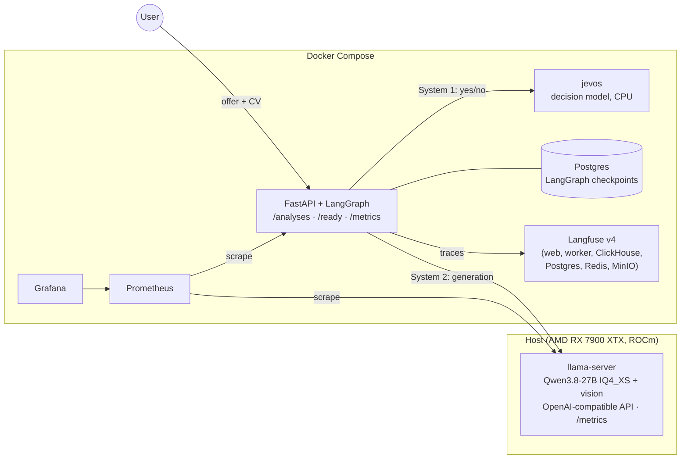
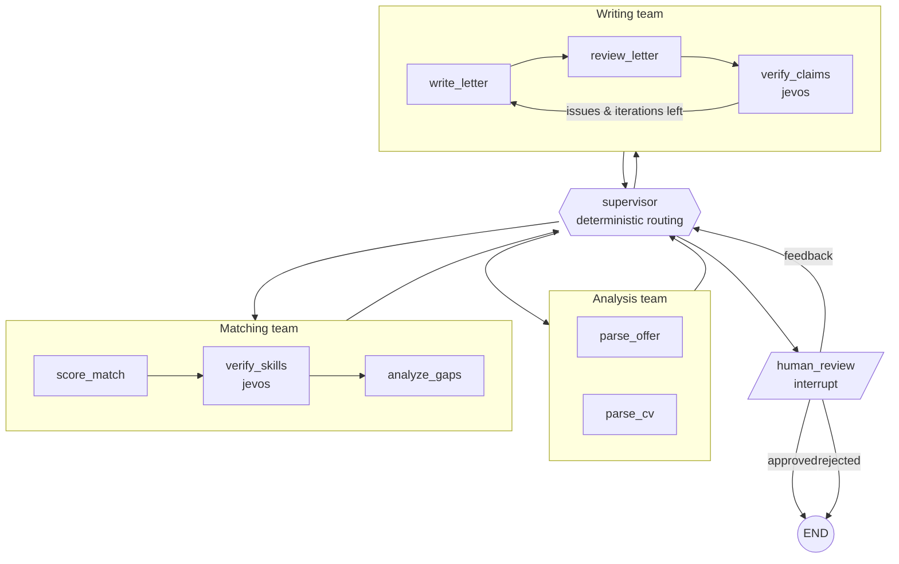

# JobMatch Agent

**🇬🇧 English** · [🇫🇷 Français](#-version-française)

> 📖 **New here?** Read the plain-language overview first (French): [docs/presentation.md](docs/presentation.md).

Hierarchical **LangGraph** multi-agent system that reads a **job offer** and a **CV**, scores the
fit, explains the skill gaps and drafts a **cover letter**, with a writer/reviewer loop and a
**human-in-the-loop** approval step. It runs **100% locally** on a quantized **Qwen3.8-27B** served by
**llama.cpp**, next to a small CPU **decision model** (jevos) for calibrated yes/no checks. It
ships with the observability and evaluation tooling a production LLM app needs: **Langfuse**
tracing, **Prometheus + Grafana** monitoring and a **DeepEval** test suite, all on
**Docker Compose**.

> Portfolio project. The goal is to show how to take an LLM application past the demo stage:
> how to measure it, trace it, evaluate it and deploy it.

## What this demonstrates

- Designing a **multi-agent graph** (LangGraph subgraphs, deterministic supervisor, interrupt/resume with a Postgres checkpointer).
- Keeping LLM output **explainable and testable**: structured output, a score computed in code, unit tests with fake models.
- **Measuring before claiming**: a DeepEval suite, an A/B harness, repeated-run stability checks, and a benchmark with calibration metrics for the decision model.
- **Iterating from evidence**: the first decision-layer design was evaluated, its bias diagnosed, and the fusion rule redesigned ([ADR 0008](docs/adr/0008-fusion-v2-after-ab-eval.md)).
- **Operating it**: traces, metrics, dashboards, readiness checks with graceful degradation, pinned images, CI, and written docs and ADRs.

## Highlights

- **Hierarchical agents**: a supervisor routes between three teams (analysis, matching, writing), and each team is its own subgraph.
- **Grounded scoring**: the LLM rates each skill (full / partial / none) and cites evidence from the CV. The score itself is computed in code (required 70%, nice-to-have 15%, experience 15%), so it can be explained and tested.
- **Decision layer (System 1 / System 2)**: Qwen ("System 2") does the generation and judgement; **jevos-v5**, a small calibrated decision model on CPU (~50 ms per question, its own `jevos` container), answers two yes/no checks: *does the CV show this skill?* (`verify_skills`) and *is this letter claim supported?* (`verify_claims`). If jevos is down, the graph falls back to LLM-only results and never fails.
- **Hallucination guard**: a reviewer agent checks every claim in the letter against the CV, jevos double-checks the flagged claims, and DeepEval measures the result.
- **Human-in-the-loop**: the graph pauses (`interrupt`) until you approve the letter, ask for changes or reject it. State is checkpointed in Postgres, so a paused analysis can still be approved after an API restart.
- **Reads scanned CVs**: PDFs with a text layer are parsed directly. Scanned PDFs and images go through Qwen's vision model (mmproj).
- **Observability**: one Langfuse trace per analysis (first run and resume land in the same trace), per-agent and decision-layer Prometheus metrics, llama.cpp server metrics and a provisioned Grafana dashboard.
- **Evaluation**: 8 annotated fictional cases, deterministic checks plus LLM-as-a-judge (G-Eval) for faithfulness, relevance and gap-advice quality, A/B comparison and score-stability runs. Scores are pushed to Langfuse.
- **Engineering**: typed contracts (Pydantic), uv, ruff, pytest (no LLM needed in CI), GitHub Actions, pinned images, non-root container.

## Architecture



### Agent graph



The supervisor's routing is **deterministic on purpose**. The pipeline is fixed, so asking an LLM to
pick the next step would add latency, cost and failure modes without adding value. LLM calls are kept
for the steps that need judgement. Details: [`docs/architecture.md`](docs/architecture.md).

## Quick start

Prerequisites: Docker with Compose, [uv](https://docs.astral.sh/uv/), and llama.cpp built with
your GPU backend plus a Qwen GGUF model (see `~/start_qwen_light.sh` for the flags used:
32k total context = 2 slots × 16k, `--jinja`, `--metrics`, mmproj for vision). Full setup:
[`docs/operations.md`](docs/operations.md).

```bash
cp .env.example .env        # local-only defaults, works as is
~/start_qwen_light.sh       # start the LLM on the host (separate terminal)
make up                     # build and start the whole stack
```

| Service | URL | Login |
|---|---|---|
| API (Swagger) | http://127.0.0.1:8000/docs | – |
| Langfuse | http://127.0.0.1:3000 | `admin@jobmatch.local` / `jobmatch-admin` |
| Grafana | http://127.0.0.1:3001 | `admin` / `admin` |
| Prometheus | http://127.0.0.1:9090 | – |
| jevos (decision model) | http://127.0.0.1:8017/health | – |

### Run an analysis

```bash
# 1. submit (the offer can also be sent as text: -F offer_text="...")
curl -s -X POST 127.0.0.1:8000/analyses \
  -F cv=@data/samples/cv_data_engineer.txt \
  -F offer=@data/samples/offer_data_engineer.txt
# -> {"id": "<uuid>", "status": "running"}

# 2. poll until status = awaiting_approval (≈6 min on a single consumer GPU)
curl -s 127.0.0.1:8000/analyses/<uuid> | jq '{status, score: .match.score, letter: .cover_letter.body}'

# 3. approve, ask for changes, or reject
curl -s -X POST 127.0.0.1:8000/analyses/<uuid>/decision \
  -H 'Content-Type: application/json' \
  -d '{"approved": false, "feedback": "Shorter, and mention the Airflow migration"}'
```

Supported files: `.txt`, `.md`, `.pdf` (text or scanned), `.png`, `.jpg`, `.webp`.
Put real personal documents in `data/private/`, which git ignores.

## Development

```bash
uv sync --all-groups
make test      # unit tests, fake LLM, no services needed
make lint      # ruff check + format check
make eval      # DeepEval suite against the running llama-server (~25-35 min for 8 cases)
make help      # all targets
```

## Evaluation

See [`evals/README.md`](evals/README.md) for the full method. The agents and the judge both use the
local Qwen, and no data leaves the machine.

**Baseline results** (8 cases, 2026-11-04, decision layer off, Qwen3.8-27B as both agent and
judge; `evals/baseline/`):

| Metric | Average | Notes |
|---|---|---|
| Score in expected range | **1.00** | 8/8 cases, from a clear mismatch (8) to a strong fit (94) |
| Must-match skills recall | **1.00** | |
| Must-flag gaps recall | **1.00** | |
| Letter faithfulness (no hallucination) | **0.93** | min 0.80 (CV without a skills section) |
| Letter relevance | **0.71** | weakest metric: low on mismatched profiles (0.30–0.40) |
| Gap-advice usefulness | **0.94** | |

Re-judging the same output moves G-Eval scores by about ±0.1, so read small differences
with care. Timing: one graph run takes about 6-7 min (386 s average per case), 2 run in
parallel, so 8 cases take ~19 min of graph time plus ~7 min of judging.

### Decision layer A/B

Same 8 cases with the decision layer **on (first version, v1)**, run on 2026-11-04
(`evals/results/compare_baseline_vs_jevos.md` and `compare_stability_off_vs_stability_on.md`;
full tables in [`docs/decision-layer.md`](docs/decision-layer.md#end-to-end-impact-ab-evaluation)):

| | Baseline (off) | jevos v1 (on) |
|---|---|---|
| Letter faithfulness / relevance | 0.925 / 0.713 | 0.943 / 0.743 (within judge noise) |
| Must-match skills recall | 1.00 | 0.93 |
| Reviewer approval rate | 12% | 0% |
| Graph errors | 0 | 1 (reviewer hit its 4096-token limit) |
| Score std, unstable case `few_skills_logistics` | 4.62 (n=3) | 0.71 (n=2) |
| Score std, `english_offer_ml` | 0.58 (n=3) | 0.58 (n=3) |

jevos made 68 decisions and agreed with the LLM on 96% of the skill checks. It checked the 11
claims flagged by the reviewer and dismissed none: those claims really were unsupported, so the
reviewer's strictness is about length and style, not false factual alarms.

**Diagnosis.** v1 fused the two opinions as `0.5 × LLM credit + 0.5 × P(evidence)`. Because a
calibrated probability rarely reaches 1.0, this pulled scores down even when both agreed
(up to -18 points on one case).

**v2 (current code).** The LLM rating is kept unless it is `partial` (then jevos' probability
decides) or the two disagree strongly (then half credit, flagged); the reviewer runs without a
token cap. **v2 has not been re-evaluated with the full suite yet.** A single smoke analysis of
the sample documents scored 90 (v1 gave 78-79 on the same sample), with every skill resolved by
the LLM rating and no reviewer error, but one run measures nothing. To measure it:
`make eval ARGS="--label jevos_v2 --decisions on"` then
`make eval-compare A=evals/baseline B=evals/results/jevos_v2`.

### Decision models benchmark

[`bench/decisions/`](bench/decisions/README.md) benchmarks **jevos**, an open-source CPU "System 1"
decision model (OpenVINO), on 194 hand-labelled French and English decisions. It reports accuracy,
macro-F1, calibration (Brier, ECE, temperature scaling) and the share of decisions that can be
automated within a 5% error budget. Key findings: on yes/no questions it is strong once the
question is phrased in English, even when the document is French (skill evidence 0.93 accuracy,
claim support 1.00), at about 50 ms and 1.5 GB RAM. On multiple-choice questions it is unreliable,
so the graph never uses it for them.

## Project layout

```
src/jobmatch/
  graph/            supervisor, teams (analysis, matching, writing), human_review
  decisions/        decision-model contract, jevos / Laya / qwen-logits backends, service used by the graph
  prompts/          prompt templates per team
  api/              FastAPI app, background runs, decision endpoint
  observability/    Prometheus metrics, Langfuse tracing
  documents.py      txt / pdf / scanned pdf / image → text
  schemas.py        Pydantic contracts shared by graph, API and evals
evals/              DeepEval suite, dataset, local judge, A/B compare
bench/decisions/    decision-model benchmark (dataset, metrics, calibration)
docs/               architecture, API, operations, observability, decision layer, ADRs
infra/              Prometheus config, Grafana provisioning + dashboard, jevos Dockerfile
tests/              unit tests (no LLM needed)
docker-compose.yml  full stack (all ports bound to 127.0.0.1)
```

Documentation index: [`docs/README.md`](docs/README.md).

## Limitations and next steps

- **Speed**: one analysis takes about 6 minutes on a single consumer GPU (27B model, ~37 tok/s; 359 s for the latest smoke run). Most of that time is the writer/reviewer loop.
- **v2 not evaluated**: the current decision-layer fusion has only one smoke run. Next step: re-run the suite and the stability runs with v2.
- **Strict reviewer**: the reviewer still blocks on length and style, so the loop often stops at its iteration cap. In the v2 smoke run it claimed that "about 280 words" was below the 250-400 range, a reasoning error. Next step: an issue severity (blocking vs minor), so that minor issues no longer block approval.
- **Self-judging**: the judge is the same model as the agents, which may bias scores upwards. A different judge model would make the evaluation more robust.
- **Small sets**: 8 eval cases, and the decision-model benchmark has only 13 and 7 English test items for the two yes/no tasks. Results separate "works" from "doesn't", not fine differences.
- **Restarts**: an analysis paused for approval survives an API restart; one that was running is marked `failed` and must be started again.

---

## 🇫🇷 Version française

Système multi-agents **LangGraph** hiérarchique. Il lit une **offre d'emploi** et un **CV**, calcule
un score de correspondance, explique les compétences manquantes et rédige une **lettre de
motivation**. Un agent relecteur vérifie la lettre, et c'est **toi qui la valides** avant la version
finale. Tout tourne **en local** sur un **Qwen3.8-27B** quantifié, servi par **llama.cpp**, avec un
petit **modèle de décision** sur CPU (jevos) pour des vérifications oui/non calibrées. Le projet
inclut l'outillage qu'il faut pour mettre une application LLM en production : traces **Langfuse**,
supervision **Prometheus + Grafana** et évaluations **DeepEval**, le tout sous **Docker Compose**.

### Ce que le projet montre

- Concevoir un **graphe multi-agents** (sous-graphes LangGraph, superviseur déterministe, pause et reprise avec un checkpointer Postgres).
- Garder une sortie LLM **explicable et testable** : sortie structurée, score calculé par le code, tests avec des modèles factices.
- **Mesurer avant d'affirmer** : suite DeepEval, comparaison A/B, mesures de stabilité, benchmark du modèle de décision avec des métriques de calibration.
- **Itérer à partir des mesures** : la première version de la couche de décision a été évaluée, son biais diagnostiqué, puis la règle de fusion revue ([ADR 0008](docs/adr/0008-fusion-v2-after-ab-eval.md)).
- **L'exploiter** : traces, métriques, tableaux de bord, sonde de disponibilité avec mode dégradé, images épinglées, CI, documentation et ADR.

### Points clés

- **Agents hiérarchiques** : un superviseur oriente le travail entre trois équipes (analyse, matching, rédaction), chacune étant un sous-graphe.
- **Score justifié** : le LLM évalue chaque compétence en citant le CV, puis le score est calculé par le code. Il peut donc être expliqué et testé.
- **Couche de décision (Système 1 / Système 2)** : Qwen rédige et juge ; **jevos-v5**, un petit modèle de décision calibré sur CPU (~50 ms par question, dans son propre conteneur), répond à deux questions oui/non : le CV montre-t-il cette compétence ? cette phrase de la lettre est-elle justifiée par le CV ? Si jevos est indisponible, le graphe garde le résultat du LLM seul et n'échoue jamais.
- **Protection contre les hallucinations** : le relecteur vérifie chaque affirmation de la lettre par rapport au CV, jevos revérifie celles qu'il signale, et DeepEval mesure le résultat.
- **Validation humaine** : le graphe se met en pause jusqu'à ce que tu valides la lettre, demandes des modifications ou la refuses. L'état est sauvegardé dans Postgres : une analyse en pause peut encore être validée après un redémarrage de l'API.
- **CV scannés** : un PDF scanné ou une image est lu par la vision de Qwen.
- **Observabilité** : une trace Langfuse par analyse, des métriques Prometheus pour chaque agent, pour la couche de décision et pour llama.cpp, et un tableau de bord Grafana prêt à l'emploi.
- **Évaluation** : 8 cas fictifs annotés, des contrôles automatiques, un LLM-juge (G-Eval), une comparaison A/B et des mesures de stabilité. Les scores sont envoyés dans Langfuse.

### Démarrage rapide

```bash
cp .env.example .env
~/start_qwen_light.sh       # lance le LLM sur la machine (dans un autre terminal)
make up                     # construit et démarre toute la stack
```

Ensuite : Swagger sur http://127.0.0.1:8000/docs, Langfuse sur http://127.0.0.1:3000, Grafana sur
http://127.0.0.1:3001. La partie anglaise ci-dessus donne les exemples `curl` et les identifiants.
Le contexte de 32k tokens est partagé entre 2 slots de 16k.

### Évaluation de la couche de décision

Comparaison A/B du 2026-11-04 (8 cas), couche de décision désactivée puis activée en
**version 1** : fidélité de la lettre 0,925 → 0,943 et pertinence 0,713 → 0,743 (dans le bruit du
juge, ±0,1), rappel des compétences 1,00 → 0,93, approbation du relecteur 12 % → 0 %, une erreur
(le relecteur a atteint sa limite de 4096 tokens). Sur le cas instable, l'écart-type du score
passe de 4,62 à 0,71. jevos est d'accord avec le LLM sur 96 % des compétences et n'a écarté
aucune des 11 affirmations signalées par le relecteur : elles étaient réellement non justifiées.

**Diagnostic** : la v1 faisait la moyenne `0,5 × LLM + 0,5 × P(preuve)`, ce qui faisait baisser
les scores, car une probabilité calibrée atteint rarement 1,0. **La v2 (code actuel)** garde la
note du LLM sauf si elle est « partielle » (jevos tranche) ou en fort désaccord (demi-crédit), et
le relecteur n'a plus de limite de tokens. **La v2 n'a pas encore été réévaluée** avec la suite
complète : une seule analyse de test (score 90, contre 78-79 en v1 sur le même exemple), ce qui
ne mesure rien. Détails : [`docs/decision-layer.md`](docs/decision-layer.md).

### Limites et prochaines étapes

- **Durée** : une analyse prend environ 6 minutes sur un seul GPU grand public.
- **v2 non évaluée** : prochaine étape, relancer l'évaluation complète et les mesures de stabilité.
- **Relecteur trop strict** : il bloque encore sur la longueur et le style, et a une fois affirmé que « 280 mots est en dessous de 250-400 » (erreur de raisonnement). Prochaine étape : une gravité par problème (bloquant ou mineur).
- **Auto-évaluation** : le juge est le même modèle que les agents, ce qui peut gonfler les scores.
- **Petits jeux de test** : 8 cas d'évaluation, et peu d'exemples en anglais dans le benchmark du modèle de décision.
- **Redémarrages** : une analyse en attente de validation survit à un redémarrage de l'API ; une analyse en cours d'exécution est marquée `failed` et doit être relancée.
