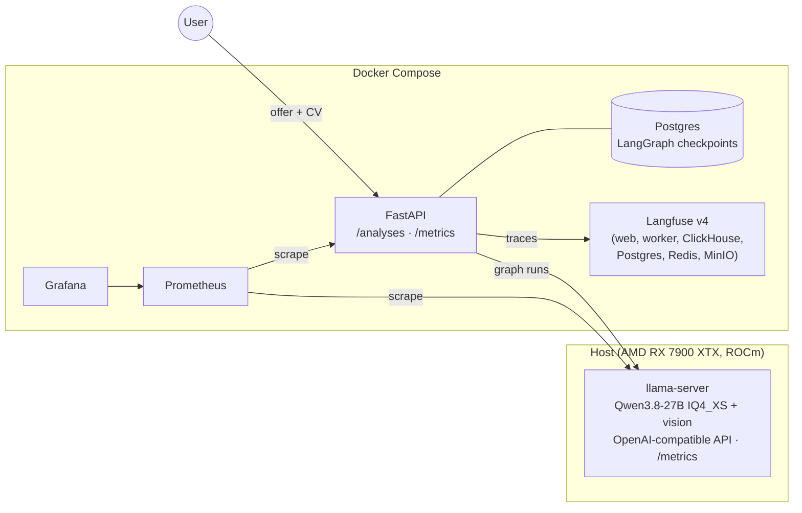
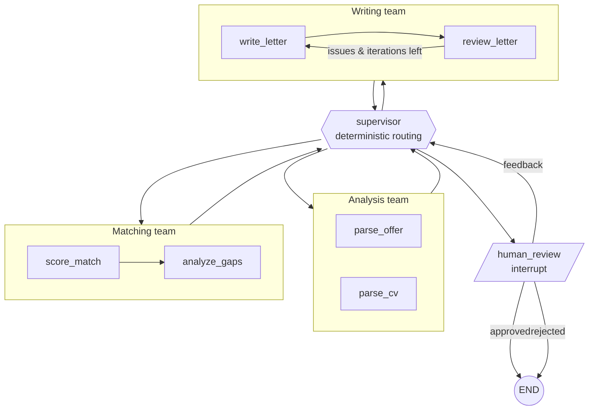

# JobMatch Agent

**🇬🇧 English** · [🇫🇷 Français](#-version-française)

Hierarchical **LangGraph** multi-agent system that reads a **job offer** and a **CV**, scores the
fit, explains the skill gaps and drafts a **cover letter**, with a writer/reviewer loop and a
**human-in-the-loop** approval step. It runs **100% locally** on a quantized **Qwen3.8-27B** served by
**llama.cpp**, and ships with the observability and evaluation tooling a production LLM app
needs: **Langfuse** tracing, **Prometheus + Grafana** monitoring and a **DeepEval** test suite, all
on **Docker Compose**.

> Portfolio project. The goal is to show how to take an LLM application past the demo stage:
> how to measure it, trace it, evaluate it and deploy it.

## Highlights

- **Hierarchical agents**: a supervisor routes between three teams (analysis, matching, writing), and each team is its own subgraph.
- **Grounded scoring**: the LLM rates each skill (full / partial / none) and cites evidence from the CV. The score itself is computed in code (required 70%, nice-to-have 15%, experience 15%), so it can be explained and tested.
- **Hallucination guard**: a reviewer agent checks every claim in the letter against the CV, and DeepEval measures the result.
- **Human-in-the-loop**: the graph pauses (`interrupt`) until you approve the letter, ask for changes or reject it. State is checkpointed in Postgres, so a run survives restarts.
- **Reads scanned CVs**: PDFs with a text layer are parsed directly. Scanned PDFs and images go through Qwen's vision model (mmproj).
- **Observability**: one Langfuse trace per analysis (first run and resume land in the same trace), per-agent Prometheus metrics, llama.cpp server metrics and a provisioned Grafana dashboard.
- **Evaluation**: 8 annotated fictional cases, deterministic checks plus LLM-as-a-judge (G-Eval) for faithfulness, relevance and gap-advice quality. Scores are pushed to Langfuse.
- **Engineering**: typed contracts (Pydantic), uv, ruff, pytest (no LLM needed in CI), GitHub Actions, pinned images, non-root container.

## Architecture



### Agent graph



The supervisor's routing is **deterministic on purpose**. The pipeline is fixed, so asking an LLM to
pick the next step would add latency, cost and failure modes without adding value. LLM calls are kept
for the steps that need judgement.

## Quick start

Prerequisites: Docker with Compose, [uv](https://docs.astral.sh/uv/), and llama.cpp built with
your GPU backend plus a Qwen GGUF model (see `~/start_qwen_light.sh` for the flags used:
32k context, 2 slots, `--jinja`, `--metrics`, mmproj for vision).

```bash
cp .env.example .env        # local-only defaults, works as is
~/start_qwen_light.sh       # start the LLM on the host (separate terminal)
make up                     # build and start the whole stack
```

| Service | URL | Login |
|---|---|---|
| API (Swagger) | http://127.0.0.1:8000/docs | – |
| Langfuse | http://127.0.0.1:3000 | `admin@jobmatch.local` / `jobmatch-admin` |
| Grafana | http://127.0.0.1:3001 | `admin` / `admin` |
| Prometheus | http://127.0.0.1:9090 | – |

### Run an analysis

```bash
# 1. submit (the offer can also be sent as text: -F offer_text="...")
curl -s -X POST 127.0.0.1:8000/analyses \
  -F cv=@data/samples/cv_data_engineer.txt \
  -F offer=@data/samples/offer_data_engineer.txt
# -> {"id": "<uuid>", "status": "running"}

# 2. poll until status = awaiting_approval (≈5 min on a single consumer GPU)
curl -s 127.0.0.1:8000/analyses/<uuid> | jq '{status, score: .match.score, letter: .cover_letter.body}'

# 3. approve, ask for changes, or reject
curl -s -X POST 127.0.0.1:8000/analyses/<uuid>/decision \
  -H 'Content-Type: application/json' \
  -d '{"approved": false, "feedback": "Shorter, and mention the Airflow migration"}'
```

Supported files: `.txt`, `.md`, `.pdf` (text or scanned), `.png`, `.jpg`, `.webp`.
Put real personal documents in `data/private/`, which git ignores.

## Development

```bash
uv sync --all-groups
make test      # unit tests, fake LLM, no services needed
make lint      # ruff check + format check
make eval      # DeepEval suite against the running llama-server (~45 min for 8 cases)
make help      # all targets
```

## Evaluation

See [`evals/README.md`](evals/README.md) for the full method. The agents and the judge both use the
local Qwen, and no data leaves the machine.

**Baseline results** (8 cases, 2026-11-04, Qwen3.8-27B as both agent and judge):

| Metric | Average | Notes |
|---|---|---|
| Score in expected range | **1.00** | 8/8 cases, from a clear mismatch (8) to a strong fit (94) |
| Must-match skills recall | **1.00** | |
| Must-flag gaps recall | **1.00** | |
| Letter faithfulness (no hallucination) | **0.93** | min 0.80 (CV without a skills section) |
| Letter relevance | **0.71** | weakest metric: low on mismatched profiles (0.30–0.40) |
| Gap-advice usefulness | **0.94** | |

Re-judging the same output moves G-Eval scores by about ±0.1, so read small differences
with care. The full per-case report is in `evals/results/` after `make eval`.

### Decision models benchmark

[`bench/decisions/`](bench/decisions/README.md) benchmarks **jevos**, an open-source CPU "System 1"
decision model (OpenVINO), on 194 hand-labelled French and English decisions. It reports accuracy,
macro-F1, calibration (Brier, ECE, temperature scaling) and the share of decisions that can be
automated within a 5% error budget. Key findings: on yes/no questions it is strong once the
question is phrased in English, even when the document is French (skill evidence 0.93 accuracy,
claim support 1.00), at about 50 ms and 1.5 GB RAM. On multiple-choice questions it is unreliable.

## Project layout

```
src/jobmatch/
  graph/            supervisor, teams (analysis, matching, writing), human_review
  prompts/          prompt templates per team
  api/              FastAPI app, background runs, decision endpoint
  observability/    Prometheus metrics, Langfuse tracing
  documents.py      txt / pdf / scanned pdf / image → text
  schemas.py        Pydantic contracts shared by graph, API and evals
evals/              DeepEval suite, dataset, local judge
infra/              Prometheus config, Grafana provisioning + dashboard
docker-compose.yml  full stack (all ports bound to 127.0.0.1)
```

## Limitations and next steps

- **Speed**: one analysis takes about 5 minutes on a single consumer GPU (27B model, ~37 tok/s). Most of that time is the writer/reviewer loop.
- **Score variance**: the same input can score a few points differently between runs. The next step is a **decision layer**: small calibrated decision models, compared with logit-based decisions from the same Qwen.
- **Self-judging**: the judge is the same model as the agents, which may bias scores upwards. A different judge model would make the evaluation more robust.
- **Strict reviewer**: the reviewer sometimes flags issues that aren't real, so the loop stops at its iteration cap.

---

## 🇫🇷 Version française

Système multi-agents **LangGraph** hiérarchique. Il lit une **offre d'emploi** et un **CV**, calcule
un score de correspondance, explique les compétences manquantes et rédige une **lettre de
motivation**. Un agent relecteur vérifie la lettre, et c'est **toi qui la valides** avant la version
finale. Tout tourne **en local** sur un **Qwen3.8-27B** quantifié, servi par **llama.cpp**. Le projet
inclut l'outillage qu'il faut pour mettre une application LLM en production : traces **Langfuse**,
supervision **Prometheus + Grafana** et évaluations **DeepEval**, le tout sous **Docker Compose**.

### Points clés

- **Agents hiérarchiques** : un superviseur oriente le travail entre trois équipes (analyse, matching, rédaction), chacune étant un sous-graphe.
- **Score justifié** : le LLM évalue chaque compétence en citant le CV, puis le score est calculé par le code. Il peut donc être expliqué et testé.
- **Protection contre les hallucinations** : le relecteur vérifie chaque affirmation de la lettre par rapport au CV, et DeepEval mesure le résultat.
- **Validation humaine** : le graphe se met en pause jusqu'à ce que tu valides la lettre, demandes des modifications ou la refuses. L'état est sauvegardé dans Postgres.
- **CV scannés** : un PDF scanné ou une image est lu par la vision de Qwen.
- **Observabilité** : une trace Langfuse par analyse, des métriques Prometheus pour chaque agent et pour llama.cpp, et un tableau de bord Grafana prêt à l'emploi.
- **Évaluation** : 8 cas fictifs annotés, des contrôles automatiques et un LLM-juge (G-Eval). Les scores sont envoyés dans Langfuse.

### Démarrage rapide

```bash
cp .env.example .env
~/start_qwen_light.sh       # lance le LLM sur la machine (dans un autre terminal)
make up                     # construit et démarre toute la stack
```

Ensuite : Swagger sur http://127.0.0.1:8000/docs, Langfuse sur http://127.0.0.1:3000, Grafana sur
http://127.0.0.1:3001. La partie anglaise ci-dessus donne les exemples `curl` et les identifiants.

### Limites et prochaines étapes

- **Durée** : une analyse prend environ 5 minutes sur un seul GPU grand public.
- **Variation du score** : un même CV peut obtenir un score un peu différent d'une exécution à l'autre. La prochaine étape est une **couche de décision** avec des modèles de décision calibrés.
- **Auto-évaluation** : le juge est le même modèle que les agents, ce qui peut gonfler les scores.
- **Relecteur trop strict** : il signale parfois des problèmes qui n'en sont pas, et la boucle s'arrête à son nombre maximal d'itérations.
