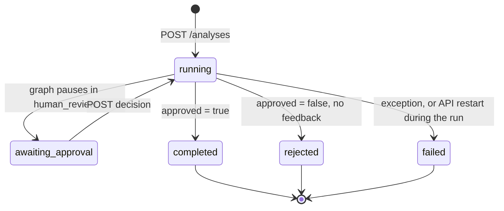

# HTTP API

FastAPI app `jobmatch.api.main:app` (title "JobMatch Agent API", version 0.1.0), served on
`http://127.0.0.1:8000`. Interactive docs: `/docs` (Swagger) and `/openapi.json`.
Routes are defined in `src/jobmatch/api/routes.py`, response models in
`src/jobmatch/api/models.py` and `src/jobmatch/schemas.py`.

There is no authentication: the API is bound to `127.0.0.1` only.

## Endpoints

| Method | Path | Purpose | Success | Errors |
|---|---|---|---|---|
| `POST` | `/analyses` | Start an analysis (CV + job offer) | 202 | 413, 415, 422 |
| `GET` | `/analyses/{analysis_id}` | Read status and results | 200 | 404 |
| `POST` | `/analyses/{analysis_id}/decision` | Approve / request changes / reject the letter | 202 | 404, 409, 422 |
| `GET` | `/health` | Liveness probe | 200 | – |
| `GET` | `/ready` | Readiness probe (database + LLM server; decision layer reported, non-critical) | 200 | 503 |
| `GET` | `/metrics` | Prometheus metrics (text format) | 200 | – |

Typical flow: `POST /analyses` → poll `GET /analyses/{id}` until `awaiting_approval` →
`POST /analyses/{id}/decision` → poll until `completed` or `rejected` (or `awaiting_approval`
again after a rewrite).

## Analysis status state machine

`status` is an `AnalysisStatus` (`src/jobmatch/schemas.py`). The API derives it from the
checkpoint and the background task (`AnalysisService._status`).



| Status | Meaning |
|---|---|
| `running` | A background task is running the graph (first run, or resume after a decision). With feedback, the writing team rewrites and reviews the letter, then the status goes back to `awaiting_approval`. |
| `awaiting_approval` | Paused on the `human_review` interrupt; `pending_review` holds the letter and the match. Survives API restarts (the checkpoint is in Postgres). |
| `completed` | The human approved the letter. Final. |
| `rejected` | The human rejected the letter without feedback. Final. |
| `failed` | The run raised an exception (`error` holds the message), or it was interrupted by an API restart while running. Final: start a new analysis. |

---

## `POST /analyses`

Start an analysis. The documents are converted to text **synchronously** (scanned PDFs and
images go through the vision LLM, so this call can take a while for them); the graph then runs
in the background.

**Request:** `multipart/form-data`

| Field | Type | Required | Description |
|---|---|---|---|
| `cv` | file | yes | Candidate CV |
| `offer` | file | one of `offer` / `offer_text` | Job offer file. Takes precedence over `offer_text`. |
| `offer_text` | string | one of `offer` / `offer_text` | Job offer as plain text |

Supported files (`src/jobmatch/documents.py`): `.txt`, `.md` (UTF-8), `.pdf` (text layer, or
scanned: first 3 pages transcribed by the vision model when the text layer has fewer than 200
characters), `.png`, `.jpg`, `.jpeg`, `.webp`. Maximum size per file: `MAX_UPLOAD_MB` (default
10 MB).

```bash
curl -s -X POST 127.0.0.1:8000/analyses \
  -F cv=@data/samples/cv_data_engineer.txt \
  -F offer=@data/samples/offer_data_engineer.txt

# or with the offer pasted as text
curl -s -X POST 127.0.0.1:8000/analyses \
  -F cv=@data/samples/cv_data_engineer.txt \
  -F offer_text="Data Engineer confirmé (H/F) ..."
```

**Response `202 Accepted`** (`AnalysisAccepted`)

```json
{"id": "3f0c2a9e-6b1d-4f7e-9a51-2d8e7c4b1a90", "status": "running"}
```

`id` is a UUID4. It is also the LangGraph `thread_id` and the Langfuse session id.

| Status | When | Body |
|---|---|---|
| 202 | Analysis started | `AnalysisAccepted` |
| 413 | A file exceeds `MAX_UPLOAD_MB` | `{"detail": "'cv' exceeds 10 MB"}` |
| 415 | Unsupported extension, unreadable PDF, non-UTF-8 text, or no readable text | `{"detail": "'cv' (cv.docx): Unsupported file type: '.docx'"}` |
| 422 | Neither `offer` nor a non-blank `offer_text` | `{"detail": "Provide either an 'offer' file or 'offer_text'"}` |
| 422 | `cv` missing (FastAPI validation) | `{"detail": [{"type": "missing", "loc": ["body", "cv"], "msg": "Field required", ...}]}` |

## `GET /analyses/{analysis_id}`

Read the current state of an analysis.

```bash
curl -s 127.0.0.1:8000/analyses/3f0c2a9e-6b1d-4f7e-9a51-2d8e7c4b1a90
```

**Response `200 OK`** (`AnalysisView`). Example while awaiting approval (illustrative values, shortened,
fictional data):

```json
{
  "id": "3f0c2a9e-6b1d-4f7e-9a51-2d8e7c4b1a90",
  "status": "awaiting_approval",
  "offer": {
    "title": "Data Engineer confirmé (H/F)",
    "company": "Lumio Énergie",
    "location": "Nantes",
    "seniority": "mid",
    "skills": [
      {"name": "Python", "level": "required"},
      {"name": "Airflow", "level": "required"},
      {"name": "Kafka", "level": "nice_to_have"}
    ],
    "responsibilities": ["Concevoir, développer et maintenir des pipelines ..."],
    "language": "fr"
  },
  "profile": {
    "name": "Camille Martin",
    "headline": "Data Engineer",
    "skills": ["Python", "SQL", "Airflow"],
    "experiences": [
      {"role": "Data Engineer", "company": "...", "duration_months": 30, "highlights": ["..."]}
    ],
    "education": ["..."],
    "languages": ["Français", "Anglais"]
  },
  "match": {
    "score": 82,
    "matched_skills": ["Python", "Airflow"],
    "gaps": [
      {"skill": "Kafka", "level": "nice_to_have", "advice": "..."}
    ],
    "strengths": ["..."],
    "summary": "...",
    "skill_checks": [
      {"skill": "Python", "level": "required", "llm_credit": 1.0,
       "p_evidence": 0.9731, "final_credit": 1.0, "agree": true, "resolution": "llm"},
      {"skill": "Airflow", "level": "required", "llm_credit": 0.5,
       "p_evidence": 0.8120, "final_credit": 0.812, "agree": true,
       "resolution": "resolved_partial"},
      {"skill": "Kafka", "level": "nice_to_have", "llm_credit": 0.0,
       "p_evidence": 0.0412, "final_credit": 0.0, "agree": true, "resolution": "llm"}
    ]
  },
  "career_plan": {
    "summary": "...",
    "gaps": [
      {"skill": "Kafka", "esco_uri": null, "esco_label": null,
       "transferable_skills": ["..."],
       "resources": [
         {"title": "Apache Kafka Quickstart", "url": "https://kafka.apache.org/quickstart",
          "provider": "Apache Software Foundation", "free": true, "est_hours": null}
       ],
       "actions": ["...", "...", "..."], "priority": "medium"}
    ],
    "tool_calls": 19
  },
  "cover_letter": {"subject": "Candidature ...", "body": "Madame, Monsieur, ...", "language": "fr"},
  "review": {
    "approved": true,
    "issues": [],
    "suggestions": ["..."],
    "unsupported_claims": [],
    "claim_checks": [
      {"claim": "...", "p_supported": 0.9412, "dismissed": true}
    ]
  },
  "review_iterations": 1,
  "trace": ["supervisor", "parse_offer", "parse_cv", "supervisor", "score_match",
            "verify_skills", "analyze_gaps", "supervisor", "career_advisor", "career_tools",
            "career_advisor", "career_tools", "career_advisor", "career_tools",
            "career_advisor", "career_plan", "supervisor",
            "write_letter", "review_letter", "verify_claims", "supervisor"],
  "pending_review": {
    "cover_letter": {"subject": "...", "body": "...", "language": "fr"},
    "match": {"score": 82, "matched_skills": ["..."], "gaps": ["..."], "...": "..."},
    "career_plan": {"summary": "...", "gaps": ["..."], "tool_calls": 19}
  },
  "error": null
}
```

Field notes:

- `offer`, `profile`, `match`, `career_plan`, `cover_letter`, `review` are `null` until the
  node that produces them has run.
- `match.skill_checks` and `review.claim_checks` are empty when the decision layer is
  disabled (`DECISIONS_ENABLED=false`) or unavailable.
- `match.skill_checks[].resolution` says how fusion v2 set `final_credit`
  ([decision-layer.md](decision-layer.md#6-how-the-graph-uses-it)): `llm` (LLM rating kept),
  `resolved_partial` (LLM said `partial`, `final_credit = p_evidence`) or `conflict` (strong
  disagreement, `final_credit = 0.5`).
- `review` is returned as `ReviewView` (`api/models.py`): the graph's `Review` plus
  `unsupported_claims` (exact quotes still considered unsupported) and `claim_checks`
  (`claim`, `p_supported`, `dismissed`). Both are listed in `/openapi.json`. The graph-side
  `schemas.Review` hides them (`SkipJsonSchema`) because its JSON schema is also the reviewer
  LLM's structured-output schema when the decision layer is off.
- `career_plan` (additive, also in `pending_review`): the career advisor's plan
  (`schemas.CareerPlan`): a `summary` and one entry per skill gap with the ESCO concept
  (`esco_uri` / `esco_label`, `null` when ESCO has none), `transferable_skills` (only those the
  decision model found in the CV), `resources` (only catalog entries returned by a tool),
  `actions` and `priority` (`high` / `medium` / `low`); `tool_calls` is counted by the code.
  With no gap, `gaps` is empty and `summary` says so. `null` when
  `CAREER_ADVISOR_ENABLED=false`. Summary and actions are written in the offer's language.
- `pending_review` is the interrupt payload; it is set only when `status` is
  `awaiting_approval`.
- `trace` lists visited nodes in order (all runs of the thread, including rewrites).
- `error` is set when `status` is `failed`.

| Status | When | Body |
|---|---|---|
| 200 | Known analysis | `AnalysisView` |
| 404 | No checkpoint, no running task and no recorded failure for this id | `{"detail": "Analysis <id> not found"}` |

## `POST /analyses/{analysis_id}/decision`

Human-in-the-loop decision on the cover letter. Body: `HumanDecision` (JSON).

| Field | Type | Description |
|---|---|---|
| `approved` | bool | `true` finishes the analysis (`completed`) |
| `feedback` | string \| null | With `approved=false`: what to change. The writer revises the letter, the reviewer checks it (including that the feedback was applied), and the analysis comes back to `awaiting_approval`. Without feedback (null or blank), the analysis is `rejected`. |

```bash
# approve
curl -s -X POST 127.0.0.1:8000/analyses/<id>/decision \
  -H 'Content-Type: application/json' -d '{"approved": true}'

# ask for a rewrite
curl -s -X POST 127.0.0.1:8000/analyses/<id>/decision \
  -H 'Content-Type: application/json' \
  -d '{"approved": false, "feedback": "Shorter, and mention the Airflow migration"}'

# reject
curl -s -X POST 127.0.0.1:8000/analyses/<id>/decision \
  -H 'Content-Type: application/json' -d '{"approved": false}'
```

**Response `202 Accepted`**: the resume runs in the background.

```json
{"id": "3f0c2a9e-6b1d-4f7e-9a51-2d8e7c4b1a90", "status": "running"}
```

| Status | When | Body |
|---|---|---|
| 202 | Resume started | `AnalysisAccepted` |
| 404 | Unknown id | `{"detail": "Analysis <id> not found"}` |
| 409 | Status is not `awaiting_approval` (still running, already decided, failed) | `{"detail": "Analysis <id> is not awaiting approval (status: running)"}` |
| 422 | Invalid body (e.g. `approved` missing) | FastAPI validation error |

Decisions are serialized by a lock, so two concurrent decisions on the same analysis resume
it at most once; the second one gets 409.

## `GET /health`

Liveness: the process answers. Used by the container `HEALTHCHECK` (`Dockerfile`).

```bash
curl -s 127.0.0.1:8000/health
```

```json
{"status": "ok"}
```

## `GET /ready`

Readiness: checks the application database (`SELECT 1`), the LLM server
(`{LLM_BASE_URL}/models`, then `/health`) and the decision layer (`{JEVOS_URL}/health`), each
with a 2-second timeout. `database` and `llm` are **critical**: `ready` is `true` only when
both pass. `decisions` is **non-critical** (`critical: false`): when it fails the API stays
ready, `degraded` is `true` and analyses run with LLM-only results. Langfuse is not checked.

| `decisions` check | `ok` | `detail` |
|---|---|---|
| `DECISIONS_ENABLED=false` | `true` | `disabled (DECISIONS_ENABLED=false)` |
| Backend other than jevos | `true` | `backend '<name>' (in-process, not probed)` |
| jevos `/health` answers 200 | `true` | the probed URL |
| jevos unreachable or not 200 | `false` | URL, error, `analyses degrade to LLM-only results` |

```bash
curl -s 127.0.0.1:8000/ready
```

**200** when every check is ok (response of the running stack):

```json
{
  "ready": true,
  "degraded": false,
  "checks": {
    "database": {"ok": true, "detail": null, "critical": true},
    "llm": {"ok": true, "detail": "http://172.17.0.1:8080/v1/models", "critical": true},
    "decisions": {"ok": true, "detail": "http://jevos:8017/health", "critical": false}
  }
}
```

**200, degraded** when only jevos is down (illustrative):

```json
{
  "ready": true,
  "degraded": true,
  "checks": {
    "database": {"ok": true, "detail": null, "critical": true},
    "llm": {"ok": true, "detail": "http://172.17.0.1:8080/v1/models", "critical": true},
    "decisions": {
      "ok": false,
      "detail": "http://jevos:8017/health -> ConnectError; analyses degrade to LLM-only results",
      "critical": false
    }
  }
}
```

**503** when a critical dependency is down (same shape, `ready: false`), for example:

```json
{
  "ready": false,
  "degraded": false,
  "checks": {
    "database": {"ok": true, "detail": null, "critical": true},
    "llm": {
      "ok": false,
      "detail": "http://172.17.0.1:8080/v1/models -> ConnectError; http://172.17.0.1:8080/health -> ConnectError",
      "critical": true
    },
    "decisions": {"ok": true, "detail": "http://jevos:8017/health", "critical": false}
  }
}
```

With an in-memory checkpointer (tests), the database check reports
`{"ok": true, "detail": "no database pool (in-memory checkpointer)"}`.

## `GET /metrics`

Prometheus text exposition of the `jobmatch_*` metrics (`src/jobmatch/observability/metrics.py`),
scraped by Prometheus as job `jobmatch-api`. Requests to `/metrics` are not counted in the HTTP
metrics. See [`observability.md`](observability.md) for the metric list.

```bash
curl -s 127.0.0.1:8000/metrics | grep jobmatch_analyses
```

## Error format

All errors raised by the routes use `ErrorResponse`:

```json
{"detail": "human-readable message"}
```

FastAPI request validation errors (wrong types, missing required fields) use FastAPI's
standard `HTTPValidationError` shape: `{"detail": [{"type", "loc", "msg", "input", ...}]}`.

| Code | Endpoint | Cause |
|---|---|---|
| 404 | `GET /analyses/{id}`, `POST .../decision` | Unknown analysis id |
| 409 | `POST .../decision` | Analysis not in `awaiting_approval` |
| 413 | `POST /analyses` | Upload larger than `MAX_UPLOAD_MB` |
| 415 | `POST /analyses` | Unsupported type, unreadable PDF, non-UTF-8 text, empty document |
| 422 | `POST /analyses`, `POST .../decision` | Missing CV/offer, or invalid request body |
| 503 | `GET /ready` | Database or LLM server unreachable (jevos down only sets `degraded`) |

Graph failures do **not** produce HTTP errors: the analysis moves to `status: "failed"` with
an `error` message, visible through `GET /analyses/{id}`.
