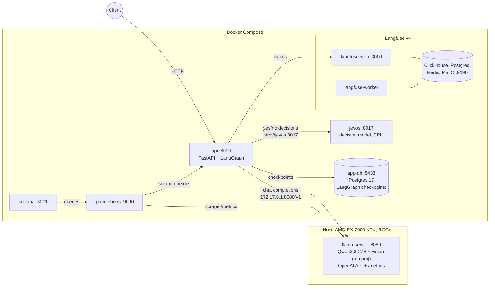
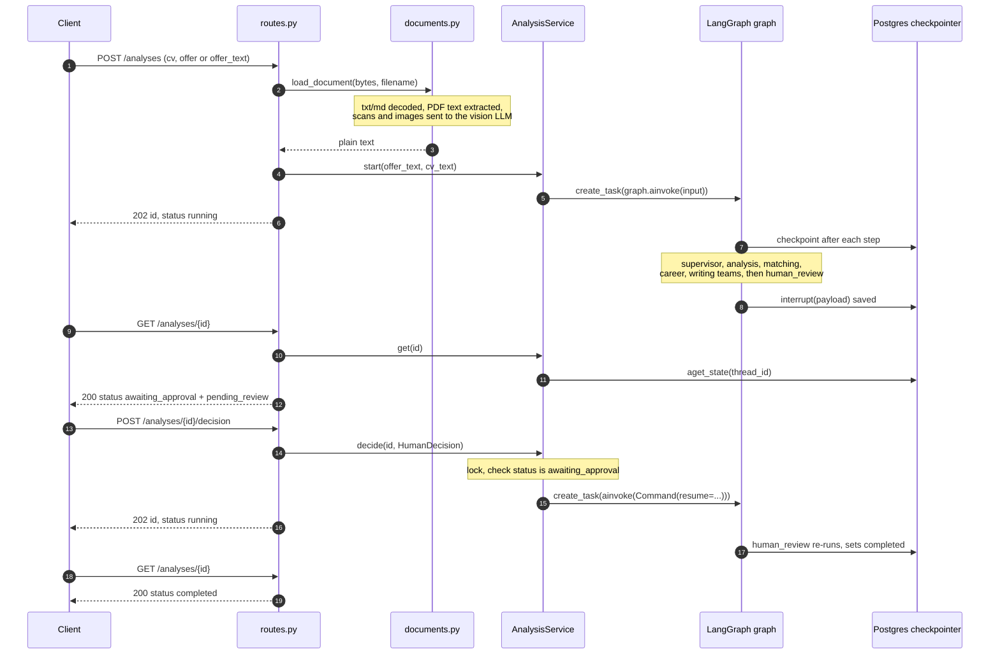
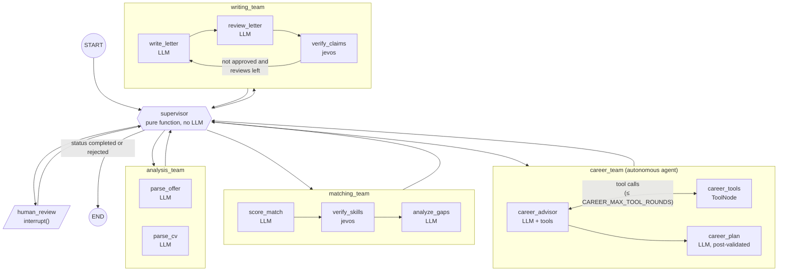
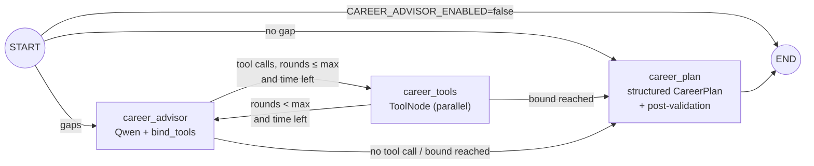
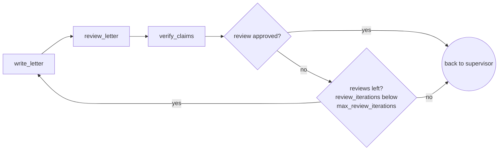

# Architecture

How JobMatch Agent turns a job offer and a CV into a match score, skill gaps, a career plan
and an approved cover letter. Every statement below is taken from the code; file paths are given so you can
check.

- [1. System overview](#1-system-overview)
- [2. Request lifecycle](#2-request-lifecycle)
- [3. Agent graph](#3-agent-graph)
- [4. State](#4-state)
- [5. Scoring](#5-scoring)
- [6. Career advisor agent](#6-career-advisor-agent)
- [7. Writer/reviewer loop and claim verification](#7-writerreviewer-loop-and-claim-verification)
- [8. Checkpointing and resume](#8-checkpointing-and-resume)
- [9. Failure handling and degradation](#9-failure-handling-and-degradation)
- [10. Module map](#10-module-map)

Design decisions are recorded separately in [`adr/`](adr/README.md).

## 1. System overview

The LLM runs on the host GPU; everything else runs in Docker Compose (`docker-compose.yml`).
All host ports are bound to `127.0.0.1`.



| Component | Role | Defined in |
|---|---|---|
| `llama-server` (host) | Qwen3.8-27B, OpenAI-compatible API, structured output (`json_schema`), vision, Prometheus metrics. Not in Docker on purpose ([ADR 0001](adr/0001-llama-cpp-on-host.md)). | `~/start_qwen_light.sh` (outside the repo) |
| `api` | FastAPI app; runs the LangGraph graph in background asyncio tasks. | `Dockerfile`, `src/jobmatch/api/` |
| `jevos` | "System 1" decision model (`jev serve`, OpenVINO, CPU), pinned release `jevos-v5` checked by SHA-256 at build time. | `infra/jevos/Dockerfile` |
| `app-db` | Application Postgres, only for LangGraph checkpoints (separate from Langfuse's Postgres). | `docker-compose.yml` |
| Langfuse v4.75.0 | Tracing: `langfuse-web`, `langfuse-worker`, `clickhouse`, `langfuse-postgres`, `redis`, `minio`. | `docker-compose.yml` |
| `prometheus` / `grafana` | Scrapes the API and llama-server; provisioned dashboard. | `infra/prometheus/prometheus.yml`, `infra/grafana/` |

Containers reach the host LLM through the Docker bridge address `172.17.0.1`. The `api`
service waits for `app-db` and `langfuse-web` to be healthy before starting. `jevos` is a soft
dependency (`condition: service_started`): without it, analyses run with LLM-only results and
`GET /ready` reports `degraded`.

## 2. Request lifecycle

One analysis is one LangGraph thread (`thread_id` = analysis id) and one Langfuse trace
(`src/jobmatch/api/service.py`). The HTTP calls return immediately; the graph runs in a
background `asyncio` task.



With `approved=false` and a `feedback` text, the resume goes back through the writing team and
pauses again on `human_review` (see [section 7](#7-writerreviewer-loop-and-claim-verification)).
The status state machine is in [`api.md`](api.md#analysis-status-state-machine).

## 3. Agent graph

The top-level graph (`src/jobmatch/graph/build.py`) has six nodes: the `supervisor`, four
team subgraphs and `human_review`. Every node hands control back to the supervisor. There are
thirteen instrumented node names in total, which are also the Prometheus `node` label and the
Langfuse span names.

Everything is a deterministic **workflow** (the code fixes the order) except `career_team`,
the one **autonomous agent**, where the LLM chooses its next tool call inside bounds set by
the code ([section 6](#6-career-advisor-agent), [ADR 0009](adr/0009-workflow-plus-autonomous-agent.md)).



| Node | Team | Does | Model |
|---|---|---|---|
| `supervisor` | top level | Routes with `next_step(state)`; sets `status` | none |
| `parse_offer` | analysis | Offer text to `JobOffer` (title, skills with level, language...); duplicate skills merged (`dedupe_skills`) | Qwen, temperature 0 |
| `parse_cv` | analysis | CV text to `CandidateProfile` (runs in parallel with `parse_offer`) | Qwen, temperature 0 |
| `score_match` | matching | Rates every offer skill `full` / `partial` / `none` with evidence, plus `experience_fit`; score computed in code | Qwen, temperature 0 |
| `verify_skills` | matching | Asks jevos "does the CV show X?" per skill, fuses with the LLM rating (fusion v2), recomputes the score | jevos |
| `analyze_gaps` | matching | Writes concrete advice for each gap (skipped if no gaps) | Qwen, default temperature (0.2) |
| `career_advisor` | career | ONE ReAct turn: the LLM, bound to 3 local tools (ESCO taxonomy, CV evidence via jevos, learning catalog), decides which tools to call or stops | Qwen + tools |
| `career_tools` | career | Runs the requested tool calls (LangGraph `ToolNode`, parallel); `cv_text` injected from the state, never passed by the LLM | tools (jevos for `check_cv_evidence`) |
| `career_plan` | career | Forced final answer `CareerPlan` from a digest of the tool loop, post-validated in code (URLs / ESCO URIs not returned by a tool dropped, transferable skills only with positive CV evidence); deterministic fallback on failure; empty plan if no gaps | Qwen |
| `write_letter` | writing | Writes or revises the cover letter in the offer's language | Qwen, temperature 0.5 |
| `review_letter` | writing | Checks the letter against the offer, profile and raw CV text; lists unsupported claims | Qwen, temperature 0, no `max_tokens` cap |
| `verify_claims` | writing | Asks jevos whether each flagged claim is supported; dismisses reviewer false positives | jevos |
| `human_review` | top level | `interrupt()` with the letter, the match and the career plan; applies the human decision on resume | none |

Supervisor routing table (`src/jobmatch/graph/supervisor.py`, first matching rule wins):

| Condition | Next |
|---|---|
| `status` is `completed` or `rejected` | `END` |
| `offer` or `profile` missing | `analysis_team` |
| `match` missing | `matching_team` |
| `career_plan` missing and `CAREER_ADVISOR_ENABLED` | `career_team` |
| `cover_letter` or `review` missing | `writing_team` |
| otherwise | `human_review` (status set to `awaiting_approval` first) |

Why routing is deterministic: [ADR 0002](adr/0002-deterministic-supervisor.md).

All LLM nodes go through `invoke_structured` (`src/jobmatch/graph/structured.py`):
`get_llm().with_structured_output(Model, method="json_schema", include_raw=True)`, token
counting, and one retry with the validation error appended if the output does not parse.

## 4. State

`JobMatchState` (`src/jobmatch/state.py`) is a `TypedDict(total=False)`. Only `trace` has a
reducer (append); every other key is overwritten by the last writer. Team subgraphs receive
the state without `trace` (`TeamInput` in `graph/teams/_common.py`) so that visited nodes are
not appended twice.

| Field | Type | Written by | Read by |
|---|---|---|---|
| `offer_text` | `str` | API (graph input) | `parse_offer` |
| `cv_text` | `str` | API (graph input) | `parse_cv`, `verify_skills`, `check_cv_evidence` (injected into the career tool), `review_letter`, `verify_claims` |
| `offer` | `JobOffer` | `parse_offer` | supervisor, `score_match`, `analyze_gaps`, career team, `write_letter`, `review_letter`, API |
| `profile` | `CandidateProfile` | `parse_cv` | supervisor, `score_match`, `analyze_gaps`, `career_advisor`, `write_letter`, `review_letter`, API |
| `match` | `MatchResult` | `score_match` (creates), `verify_skills`, `analyze_gaps` (update) | supervisor, career team (`match.gaps`), `write_letter`, `human_review`, API, metrics |
| `score_assessment` | `ScoreAssessment` | `score_match` | `verify_skills` |
| `career_plan` | `CareerPlan` | `career_plan` (career team; its tool-loop `messages` stay in the subgraph state) | supervisor, `human_review`, API |
| `cover_letter` | `CoverLetter` | `write_letter` | supervisor, `write_letter` (revision), `review_letter`, `human_review`, API |
| `review` | `Review` | `review_letter`, `verify_claims`; set to `None` by `human_review` on feedback | supervisor, `route_after_review`, `write_letter` (revision), API |
| `review_iterations` | `int` | `review_letter` (+1); reset to 0 by `human_review` on feedback | `route_after_review`, API, metrics |
| `human_feedback` | `str \| None` | `human_review` | `write_letter`, `review_letter` |
| `status` | `AnalysisStatus` | supervisor (`running`, `awaiting_approval`), `human_review` (`completed`, `rejected`, `running`), API on failure (`failed`) | supervisor, API |
| `error` | `str \| None` | API on failure (`aupdate_state`) | API |
| `trace` | `list[str]` (append) | every node | API (`AnalysisView.trace`) |

## 5. Scoring

The LLM never outputs the score. It rates each skill and the code computes the score
(`src/jobmatch/graph/teams/matching.py`, [ADR 0003](adr/0003-score-computed-in-code.md)).

### Rubric

| Component | Weight | Coverage |
|---|---|---|
| Required skills | 0.70 | mean credit of required skills |
| Nice-to-have skills | 0.15 | mean credit of nice-to-have skills |
| Experience fit | 0.15 | `experience_fit / 100` (LLM rating, 0-100) |

```
score = round(100 * Σ(weight_i * coverage_i) / Σ(weight_i))
```

A skill category with no skills is left out, so its weight is redistributed over the others
(for an offer with no nice-to-have skills, the effective weights are 0.70/0.85 and 0.15/0.85).
The skill level is taken from the parsed offer, not from the LLM's copy of it.

**One entry per skill.** The LLM sometimes lists a skill twice (for example "AWS" as both
required and nice-to-have). `parse_offer` merges offer skills by case-insensitive name, keeping
the first occurrence and the strongest level (required wins, `dedupe_skills` in
`graph/teams/analysis.py`). `score_match` also keeps a single rating per skill, so a duplicate
can no longer be counted twice in the score.

### Credits

| Mode | Credit per skill | Matched | Gap |
|---|---|---|---|
| LLM only (`score_match`, or decision layer off/unavailable) | `full` = 1, `partial` = 0.5, `none` = 0 | `match != "none"` | `match != "full"` |
| Fused (`verify_skills`, fusion v2) | see the table below | `final_credit >= 0.5` | `final_credit < 0.5` |

`p_evidence` is jevos' P(yes) to an English question ("Does the CV show that the person has
actually used X?"), calibrated with temperature scaling (`T = 0.735` for `skill_evidence`,
fitted by the benchmark: `bench/decisions/results/summary.json`). Fusion v2
(`fuse_skill` in `decisions/service.py`), with `c` the LLM credit and `p` = `p_evidence`:

| LLM rating | Condition | `final_credit` | `resolution` |
|---|---|---|---|
| `partial` (c = 0.5) | always | `p` (jevos decides) | `resolved_partial` |
| `full` (c = 1) | `p < DECISION_CONFLICT_LOW` (0.2) | 0.5 (stays matched, half credit) | `conflict` |
| `none` (c = 0) | `p > DECISION_CONFLICT_HIGH` (0.8) | 0.5 (becomes matched, half credit) | `conflict` |
| `full` or `none` | otherwise | `c` (LLM kept) | `llm` |

Why v2: the v1 rule `0.5 * llm_credit + 0.5 * p_evidence` biased scores down, because `p`
rarely reaches 1.0, while jevos agreed with the LLM on 96% of skills in the A/B eval
([ADR 0008](adr/0008-fusion-v2-after-ab-eval.md),
[decision-layer.md](decision-layer.md#end-to-end-impact-ab-evaluation)). v2 changes the score
only where the LLM is unsure or strongly contradicted.

Each fused skill is stored in `match.skill_checks[]` (`llm_credit`, `p_evidence`,
`final_credit`, `agree`, `resolution`) and counted in `jobmatch_skill_resolution_total`.

## 6. Career advisor agent

`career_team` (`src/jobmatch/graph/teams/career.py`) is the only place where the LLM decides
the next step. It runs after `matching_team`, reads `offer`, `profile`, `match.gaps` and
`cv_text`, and writes `career_plan` (`CareerPlan`: a `summary` and one `GapPlan` per gap with
ESCO concept, verified transferable skills, catalog resources, actions and priority). Why an
agent here and a workflow elsewhere: [ADR 0009](adr/0009-workflow-plus-autonomous-agent.md).



| Tool | Does | Source |
|---|---|---|
| `search_skill_taxonomy(query, language, limit)` | Fuzzy EN/FR, accent-insensitive search; returns URI, labels, short description and up to 8 related skills | `data/career/esco_skills.json` (ESCO, CC BY 4.0) |
| `check_cv_evidence(skill)` | Calibrated P(the CV shows `skill`) via `check_skill_evidence` (jevos). `cv_text` is injected from the state (`InjectedState`), the LLM never passes it. Returns `present: null` when the decision layer is off or down | decision layer |
| `search_learning_resources(skill, limit)` | Curated resources (title, URL, provider, kind, free, level, language, hours); the only allowed source of URLs | `data/career/learning_resources.json` |

Bounds and guardrails, all in code:

| Guardrail | Value | Where |
|---|---|---|
| Tool-calling LLM turns | `CAREER_MAX_TOOL_ROUNDS` (6) | `route_after_advisor`, `route_after_tools` |
| Wall time of the loop | `CAREER_TIMEOUT_S` (120 s), from the first advisor turn | `career_advisor`, routing |
| Final structured call | at least `MIN_PLAN_BUDGET_S` (180 s), then deterministic fallback | `career_plan` |
| `limit` argument chosen by the LLM | clamped to 1-10 | `_limit`, `career/tools.py` |
| Research digest fed to `career_plan` | 12,000 characters max | `Evidence.research` |
| Unknown ESCO URIs / resource URLs in the plan | dropped (URLs counted in `jobmatch_career_resources_dropped_total`) | `ground_plan` |
| Transferable skills | kept only if `check_cv_evidence` returned present with p ≥ 0.5 | `ground_plan` |
| Missing gap in the LLM plan | rebuilt from that gap's tool results and its advice | `ground_plan` |

The tool-loop `messages` live in the subgraph state (`CareerState`) and are not copied to
`JobMatchState`. `career_plan.tool_calls` is set by the code. The plan is returned by the API
and shown in the human review payload; the writing team does not read it.

Smoke run on `data/samples` (2026-11-04, one run, not an evaluation): `career_team` took
about 167 s (advisor 87 s, tools 0.5 s, final plan 79 s) for 4 gaps, with 3 tool rounds and
19 tool calls; the whole analysis took 491 s.

## 7. Writer/reviewer loop and claim verification



- **Budget.** `max_review_iterations = 2` (`config.py`): at most two reviews per writing
  round. When the budget is used up the letter goes to the human anyway, with the last
  review attached.
- **Reviewer as hallucination guard.** `review_letter` receives the structured profile *and*
  the raw CV text and must flag every claim not supported by the CV. Any open issue forces
  `approved = false`.
- **No token cap on the reviewer.** `review_letter` runs with `max_tokens` unset
  (`REVIEWER_MAX_TOKENS = None`), bounded only by the 16k per-slot context. With the default
  4096-token budget, Qwen's thinking plus a long review was cut (`finish_reason=length`) and
  the analysis failed: this happened once in the A/B eval
  (`evals/results/jevos/report.md`, case `employment_gap_accountant`).
- **Decision layer on** (`DECISIONS_ENABLED=true`, default). The reviewer uses
  `REVIEW_LETTER_CLAIMS_PROMPT` and the `ReviewerOutput` schema: unsupported claims are listed
  separately as exact quotes (`unsupported_claims`), other problems go in `issues`. Each claim
  becomes an issue `Unsupported claim (not backed by the CV): "..."`.
- **`verify_claims`.** For each quoted claim, jevos returns calibrated P(supported)
  (`T = 0.886`). If `p_supported >= claim_dismiss_threshold` (0.8), the claim is treated as a
  reviewer false positive: its issue is removed and `jobmatch_claims_dismissed_total` is
  incremented. The review is approved if no issue remains. Results are in
  `review.claim_checks[]`.
- **Decision layer off.** The reviewer uses its original prompt and `Review` schema;
  `verify_claims` is a no-op. This is the A/B baseline used by the evals.
- **Revisions.** On a rewrite, `write_letter` gets the previous draft, the review's issues
  and suggestions, and the human feedback (`REVISION_CONTEXT`). With human feedback,
  `review_letter` also checks that the feedback was applied (`HUMAN_FEEDBACK_CHECK`).

Why `verify_claims` exists: in the baseline evals the reviewer approved 12% of the letters
and used an average of 2.00 review iterations, i.e. it almost always hit the cap
(`evals/results/compare_baseline_vs_baseline.md`, "Graph behaviour").

## 8. Checkpointing and resume

- **Checkpointer.** `AsyncPostgresSaver` on a `psycopg` pool (`max_size=10`, autocommit) to
  `app-db`, created in the FastAPI lifespan (`api/main.py`). `saver.setup()` creates its
  tables at startup.
- **Serializer.** `checkpoint_serializer()` (`graph/build.py`) allow-lists every class of
  `jobmatch.schemas`, so Pydantic/Enum values in the state can be deserialized on resume.
- **Thread id.** `thread_id` = analysis id (UUID4). The API reads the state with
  `graph.aget_state()`; the checkpointer is the source of truth, the service only keeps the
  running tasks and failures in memory.
- **Pause.** The supervisor sets `status = awaiting_approval` *before* entering
  `human_review`, because `interrupt()` pauses inside the node. The interrupt payload
  (`cover_letter` + `match` + `career_plan`, `null` when the advisor is disabled) is returned
  by the API as `pending_review`.
- **Resume.** `POST /analyses/{id}/decision` runs `graph.ainvoke(Command(resume=decision))`
  with the same thread id. `human_review` re-runs from the top and `interrupt()` returns the
  decision. A global `asyncio.Lock` around the status check prevents two concurrent decisions
  from resuming the same thread.
- **One trace per analysis.** The Langfuse handler is created with `trace_seed = analysis id`,
  so the first run and the resume land in the same trace (`observability/tracing.py`).
- **Restarts.** A paused analysis lives in Postgres and can still be approved after an API
  restart. A run that was *in progress* during a restart is not resumed: its checkpoint has
  pending nodes but no interrupt and no task, so the API reports it as `failed` with
  "run stopped unexpectedly (e.g. API restart); please start a new analysis".

Rationale: [ADR 0004](adr/0004-hitl-interrupt-postgres.md).

## 9. Failure handling and degradation

| Failure | Behaviour | Where |
|---|---|---|
| LLM output does not match the schema | One retry with the parsing error appended, then `StructuredOutputError` | `graph/structured.py` |
| LLM reply cut by the token limit (`LengthFinishReasonError`) | No retry (the same call would hit the same limit): `StructuredOutputError` naming the node and token counts. The reviewer has no cap | `graph/structured.py`, `graph/teams/writing.py` |
| LLM HTTP error / timeout | `ChatOpenAI(max_retries=2, timeout=300 s)` | `llm.py`, `config.py` |
| Any exception in a node | `jobmatch_agent_node_errors_total{node}` incremented, exception propagates. LangGraph control flow (`GraphInterrupt` from `human_review`) is re-raised without counting | `observability/metrics.py` |
| Exception in a background run | Logged, `status=failed` + `error` (max 1000 chars) written to the checkpoint; in-memory fallback if that write fails; `jobmatch_analyses_total{status="failed"}` | `api/service.py` |
| jevos down, error, or decision layer disabled | `check_skill_evidence` / `check_claims` return `[]`; the graph keeps the LLM-only result. Warning logged once, then debug; `jobmatch_decisions_total{outcome="error"}` | `decisions/service.py` |
| CV longer than 24,000 characters (jevos context is 8192 tokens, no truncation) or HTTP 422 from jevos | Decision skipped (`outcome="skipped"`), LLM-only result kept | `decisions/service.py` |
| Career tool error or empty result | The tool returns a `note` instead of raising (`status="error"` / `"empty"` in `jobmatch_career_tool_calls_total`); the advisor can try another query | `graph/teams/career.py` `_run_tool`, `career/tools.py` |
| Career advisor LLM call fails or the loop exceeds `CAREER_TIMEOUT_S` / `CAREER_MAX_TOOL_ROUNDS` | The final answer is forced: `career_plan` runs with what the tools returned | `graph/teams/career.py` |
| `career_plan` structured call fails or times out (budget ≥ 180 s) | Deterministic fallback plan from the tool results and the gap advice; the analysis continues | `graph/teams/career.py` `ground_plan` |
| Langfuse unreachable or disabled | No callback handler, the run continues untraced. Health check cached for 30 s | `observability/tracing.py` |
| Upload too large, unsupported type, empty text | 413 / 415 before any graph run | `api/routes.py`, `documents.py` |
| Database or LLM down | `GET /ready` returns 503 with per-dependency details | `api/routes.py` |
| jevos down at startup or run time | The api still starts (soft compose dependency); `GET /ready` stays 200 with `degraded: true`; analyses run LLM-only | `docker-compose.yml`, `api/routes.py` |
| Postgres unreachable at startup | Pool opening waits up to 15 s, then the app fails to start | `api/main.py` |

## 10. Module map

| Module | Purpose |
|---|---|
| `src/jobmatch/config.py` | `Settings` (pydantic-settings, `.env`); read only through `get_settings()` |
| `src/jobmatch/llm.py` | `get_llm()` (ChatOpenAI pointed at llama-server) and `image_message()` for vision |
| `src/jobmatch/schemas.py` | Pydantic domain models shared by graph, API and evals |
| `src/jobmatch/state.py` | `JobMatchState` and the documented graph interface |
| `src/jobmatch/documents.py` | `load_document()`: txt/md, PDF text layer, scanned PDF (first 3 pages) and images via vision |
| `src/jobmatch/prompts/` | Prompt templates, one module per team (`analysis`, `matching`, `career`, `writing`) |
| `src/jobmatch/graph/build.py` | `build_graph(checkpointer)` and `checkpoint_serializer()` |
| `src/jobmatch/graph/supervisor.py` | Deterministic `next_step()` routing and the `supervisor` node |
| `src/jobmatch/graph/human_review.py` | `human_review` node (`interrupt()` and decision handling) |
| `src/jobmatch/graph/structured.py` | `invoke_structured()`: structured output, token metrics, one retry |
| `src/jobmatch/graph/teams/analysis.py` | `parse_offer` and `parse_cv` in parallel |
| `src/jobmatch/graph/teams/matching.py` | `score_match`, `verify_skills`, `analyze_gaps`, scoring rubric |
| `src/jobmatch/graph/teams/career.py` | `career_advisor`, `career_tools`, `career_plan`: bounded ReAct loop, tool wrappers, post-validation (`ground_plan`) |
| `src/jobmatch/career/tools.py` | The three local career tools (ESCO search, CV evidence, learning catalog); no network at runtime |
| `src/jobmatch/graph/teams/writing.py` | `write_letter`, `review_letter`, `verify_claims`, loop routing |
| `src/jobmatch/graph/teams/_common.py` | `TeamInput` schema (state without `trace`), `to_json()` |
| `src/jobmatch/decisions/base.py` | `DecisionModel` / `Question` / `Decision` contract |
| `src/jobmatch/decisions/registry.py` | Backend registry with lazy imports (`jevos`, `laya`, `qwen-logits`, `qwen-logits-perm`) |
| `src/jobmatch/decisions/service.py` | `check_skill_evidence()`, `check_claims()`, `fuse_skill()`: English questions, calibration (jevos only), fusion v2, degradation |
| `src/jobmatch/decisions/jevos_backend.py` | HTTP client for `jev serve`; can spawn a local binary if no server answers |
| `src/jobmatch/decisions/laya_backend.py` | Laya encoder backend (benchmark only, needs the `decisions` dependency group) |
| `src/jobmatch/decisions/qwen_logits.py` | Option-letter logprob decisions from llama-server (benchmark only) |
| `src/jobmatch/observability/metrics.py` | Prometheus metrics, `instrument_node`, `record_llm_usage` |
| `src/jobmatch/observability/tracing.py` | Langfuse handler factory, run config, flush |
| `src/jobmatch/api/main.py` | FastAPI app factory, lifespan (checkpointer), HTTP metrics middleware |
| `src/jobmatch/api/routes.py` | HTTP endpoints (see [`api.md`](api.md)) |
| `src/jobmatch/api/service.py` | `AnalysisService`: background runs, status derivation, resume, failure marking |
| `src/jobmatch/api/models.py` | HTTP response models |
| `data/career/` | ESCO snapshot (272 concepts, CC BY 4.0) and curated learning catalog (107 entries) read by the career tools ([README](../data/career/README.md)) |
| `scripts/` | `build_esco_snapshot.py` (rebuild the ESCO snapshot from the public ESCO API), `verify_learning_resources.py` (link check of the catalog) |
| `evals/` | DeepEval suite with local Qwen judge ([`evals/README.md`](../evals/README.md)) |
| `bench/decisions/` | Decision-model benchmark ([`bench/decisions/README.md`](../bench/decisions/README.md)) |
| `infra/` | Prometheus config, Grafana provisioning and dashboard, jevos Dockerfile |
