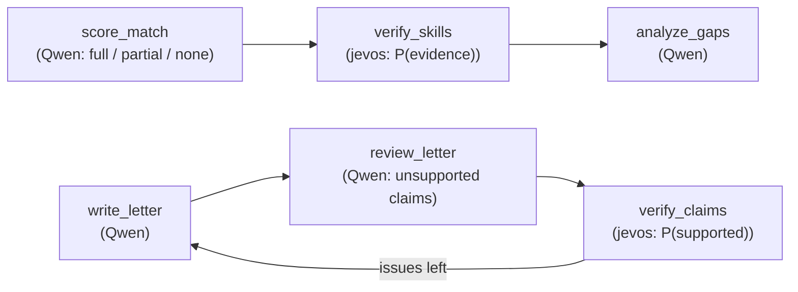

# Decision layer ("System 1")

A small, calibrated **decision model** answers closed yes/no questions next to the LLM. It
runs on the CPU in about 50 ms and returns a probability instead of free text. Qwen stays in
charge of everything that needs generation or judgement.

Sources: `src/jobmatch/decisions/`, `bench/decisions/` (README, BACKENDS.md,
`results/report.md`, `results/summary.json`), `src/jobmatch/graph/teams/matching.py`,
`src/jobmatch/graph/teams/writing.py`.

## 1. The idea

| | System 2: Qwen3.8-27B (GPU) | System 1: jevos-v5 (CPU) |
|---|---|---|
| Answers | Free text / JSON, with reasoning | One probability per option, single shot |
| Speed | Seconds to minutes per call | ~50 ms per question (benchmark p50) |
| Used for | Parsing, scoring rubric, gap advice, letter writing, review | Two yes/no checks: skill evidence, claim support |
| Output | Can drift between runs | Deterministic probability, calibrated by temperature scaling |

Several steps of the graph boil down to closed questions: *does this CV show Docker?*, *is
this letter sentence supported by the CV?* A long LLM call with "thinking" answers them
slowly and gives no usable confidence. A decision model that is **accurate and calibrated**
can answer the confident cases instantly and give a probability that the code can combine
with the LLM's verdict.



## 2. Contract and backends

Contract (`decisions/base.py`): `await model.decide(state, Question(kind, question, options))`
returns `Decision.probs` (one probability per option, summing to 1). Kinds: `yes_no`,
`choice` (2-16 options), `score` (ordinal levels). Backends are created lazily by
`decisions/registry.py`.

| Backend | What it is | Status |
|---|---|---|
| `jevos` | jevos-v5 ([feder-cr/jev](https://github.com/feder-cr/jev), MIT): small decoder model, OpenVINO INT8, C++ `jev serve` over HTTP, CPU only. 8192-token context, no truncation. | **Wired in the graph** (default `DECISIONS_BACKEND`), benchmarked, calibrated. Runs as the `jevos` compose service (pinned release, SHA-256 checked). |
| `laya` | Laya encoder decision model ([convaiinnovations/laya](https://huggingface.co/convaiinnovations/laya), Apache-2.0), PyTorch CPU, in-process. | Implemented and smoke-tested; **kept, not benchmarked**. Needs `uv sync --group decisions` (not in the API image). Default `max_len=1024` truncates long CVs. |
| `qwen-logits` / `qwen-logits-perm` | Same Qwen on llama-server: options labelled A, B, …, one call with `max_tokens=1` and `logprobs`, probabilities read from the option letters (`-perm` also asks with reversed options and averages). | Implemented and unit-tested; **benchmark not run** (lead decision, `bench/decisions/README.md`). Would use the GPU that the agents already share. |

Smoke-test observations (9 items, `BACKENDS.md`): jevos-v5 answered 9/9, warm p50 17 ms with
its state cache; Laya multilingual 8/9 at 52 ms and 2.3 GB RSS. These were enough to pick
jevos for the full benchmark.

## 3. Benchmark method

### Dataset

194 hand-labelled, fictional items built by `bench/decisions/build_dataset.py` from the eval
cases, the sample documents, generated cover letters and extra documents written for the
benchmark.

| Task | Kind | Items | Content |
|---|---|---|---|
| `skill_evidence` | yes/no | 102 | CV + "has the person actually used X?". Includes paraphrases (*conteneurisation* ↔ Docker, OpenShift ↔ Kubernetes), course/hobby-only mentions, homonyms (the writer Kafka vs Apache Kafka), close-but-absent skills. |
| `claim_supported` | yes/no | 52 | CV + one cover-letter sentence: real sentences from generated letters and crafted subtle falsehoods (wrong numbers, inflated duration, invented management). |
| `seniority` | choice | 20 | junior / mid / senior / lead. |
| `doc_type` | choice | 20 | cv / job_offer / other (including hard "other" cases). |

About 20 % of items are English. Each task is split **stratified by label**: ~30 % `calib`
(used only to fit the temperature) and ~70 % `test` (all reported numbers).

| Task | FR calib / test | EN calib / test |
|---|---|---|
| skill_evidence | 26 / 58 | 5 / 13 |
| claim_supported | 10 / 29 | 6 / 7 |
| seniority | 5 / 10 | 2 / 3 |
| doc_type | 6 / 9 | 0 / 5 |

### Runs

- `jevos`: questions in the item's language (French questions for French documents).
- `jevos@q-en`: **same model, same documents**, but every question is the English version.
  This separates *question language* from *document language*.
- `majority-baseline`: predicts the calib-split class frequencies (sanity floor).

### Metrics, in plain words

| Metric | Meaning |
|---|---|
| **Accuracy** | Share of test items where the most probable answer is right. |
| **Macro-F1** | F1 computed for each class (yes and no) and then averaged. A model that always answers "yes" can have decent accuracy but gets a poor macro-F1, because it fails the "no" class. |
| **Brier** | Mean squared error between the probabilities and the truth (0 = perfect, 0.5 = a coin flip on yes/no). Rewards being right *and* honest about confidence. |
| **ECE** | Expected calibration error: average gap between confidence and accuracy (10 bins). 0.05 ≈ "when it says 90 %, it is right 85-95 % of the time". |
| **Temperature scaling** | One parameter T fitted on the calib split: pₖ ∝ pₖ^(1/T). T > 1 softens an over-confident model, T < 1 sharpens an under-confident one. It never changes the argmax, so accuracy and F1 do not change. |
| **auto@5%** | *Automatable share at a 5 % error budget*: sort test items by confidence, answer the most confident automatically, and keep the largest share whose error rate stays ≤ 5 %. 0.88 = 88 % of decisions could be automated with ≤ 5 % errors. The cut-off is chosen on the test set itself, so it is an optimistic upper bound. |

Pass bar ("very good"): on each yes/no task and **each language**, accuracy ≥ 0.85 and
calibrated auto@5% ≥ 0.5. The report also gives a Wilson 95 % lower bound on accuracy.

## 4. Results

From `bench/decisions/results/report.md` (generated 2026-11-04), test split.

### skill_evidence (yes/no)

| Run | Lang | n | acc | macro-F1 | Brier cal | ECE cal | T | auto@5% cal | p50 ms |
|---|---|---|---|---|---|---|---|---|---|
| majority-baseline | all | 71 | 0.563 | 0.360 | 0.492 | 0.015 | 0.97 | 0.00 | – |
| jevos | fr | 58 | 0.879 | 0.878 | 0.179 | 0.030 | 0.86 | 0.78 | 50 |
| jevos | en | 13 | 1.000 | 1.000 | 0.041 | 0.113 | 0.86 | 1.00 | 40 |
| jevos@q-en | fr | 58 | **0.931** | 0.930 | 0.137 | 0.069 | 0.74 | **0.88** | 46 |
| jevos@q-en | en | 13 | 1.000 | 1.000 | 0.030 | 0.089 | 0.74 | 1.00 | 41 |
| jevos@q-en | all | 71 | 0.944 | 0.943 | 0.117 | 0.056 | 0.74 | 0.94 | 45 |

### claim_supported (yes/no)

| Run | Lang | n | acc | macro-F1 | Brier cal | ECE cal | T | auto@5% cal | p50 ms |
|---|---|---|---|---|---|---|---|---|---|
| majority-baseline | all | 36 | 0.472 | 0.321 | 0.500 | 0.028 | 20.00 | 0.00 | – |
| jevos | fr | 29 | **0.414** | 0.293 | 0.691 | 0.373 | 1.49 | 0.17 | 61 |
| jevos | en | 7 | 1.000 | 1.000 | 0.054 | 0.148 | 1.49 | 1.00 | 36 |
| jevos@q-en | fr | 29 | **1.000** | 1.000 | 0.018 | 0.069 | 0.89 | **1.00** | 56 |
| jevos@q-en | en | 7 | 1.000 | 1.000 | 0.014 | 0.060 | 0.89 | 1.00 | 32 |
| jevos@q-en | all | 36 | 1.000 | 1.000 | 0.017 | 0.067 | 0.89 | 1.00 | 54 |

### Choice tasks (for information)

| Run | Task | acc (all) | macro-F1 (all) | auto@5% cal (all) |
|---|---|---|---|---|
| jevos | seniority (n=13) | 0.462 | 0.499 | 0.00 |
| jevos@q-en | seniority (n=13) | 0.538 | 0.563 | 0.00 |
| jevos | doc_type (n=14) | 0.429 | 0.344 | 0.07 |
| jevos@q-en | doc_type (n=14) | 0.500 | 0.413 | 0.00 |

### Verdict on yes/no tasks

| Run | Task | Lang | acc | Wilson 95 % low | auto@5% cal | Pass |
|---|---|---|---|---|---|---|
| jevos | skill_evidence | fr | 0.879 | 0.77 | 0.78 | yes |
| jevos | skill_evidence | en | 1.000 | 0.77 | 1.00 | yes |
| jevos | claim_supported | fr | 0.414 | 0.26 | 0.17 | **no** |
| jevos | claim_supported | en | 1.000 | 0.65 | 1.00 | yes |
| jevos@q-en | skill_evidence | fr | 0.931 | 0.84 | 0.88 | yes |
| jevos@q-en | skill_evidence | en | 1.000 | 0.77 | 1.00 | yes |
| jevos@q-en | claim_supported | fr | 1.000 | 0.88 | 1.00 | yes |
| jevos@q-en | claim_supported | en | 1.000 | 0.65 | 1.00 | yes |

### Resources

jevos server peak RSS about 1.5 GB (1558 MB measured as a child process of the benchmark),
load 2.1 s (backend construction + first decision, `jev serve` spawned by the benchmark),
7 s for the whole run at concurrency 2 (`report.md`, Resources). No GPU.

## 5. Key finding: the question language matters

Accuracy on **French documents**, same model, only the question language changes:

| Task | French question (`jevos`) | English question (`jevos@q-en`) |
|---|---|---|
| skill_evidence | 0.879 | 0.931 |
| claim_supported | 0.414 | 1.000 |

jevos is English-only according to its authors. It reads French documents well, but it fails
when the **question** is French: on `claim_supported` it drops below the majority baseline.
Since the graph writes the questions, the fix is free: **always ask in English**, whatever the
language of the CV. `decisions/service.py` copies the English templates verbatim from
`build_dataset.py` (`SKILL_Q["en"]`, `CLAIM_Q["en"]`) so that the benchmark numbers apply.

Choice tasks (seniority, doc_type) stay unreliable in both languages, so they are not used.

## 6. How the graph uses it

### `verify_skills` (matching team)

After `score_match` rates every offer skill `full` / `partial` / `none`, jevos is asked for
each skill:

> Does the CV show that the person has actually used "{skill}"? (Counts as yes: use in a job,
> internship or concrete project, or a skill listed without qualification. Does not count:
> mere 'basic knowledge', a course taken or in progress, a hobby, or a homonym.)

The calibrated probability is fused with the LLM's credit:

```
llm_credit   = {full: 1.0, partial: 0.5, none: 0.0}
final_credit = 0.5 * llm_credit + 0.5 * p_evidence
matched      = final_credit >= 0.5      (otherwise the skill is a gap)
```

The score is recomputed with the same rubric (required 70 %, nice-to-have 15 %, experience
15 %) using `final_credit`. In practice:

| LLM rating | Effect of jevos |
|---|---|
| `full` | Always stays matched; its credit drops toward 0.5 if jevos finds little evidence. |
| `partial` | jevos decides: matched if P(evidence) ≥ 0.5, gap otherwise. |
| `none` | Stays a gap (it would need P = 1.0 to reach 0.5), but can earn up to 0.5 credit in the score. |

Each result is stored in `match.skill_checks[]` (`llm_credit`, `p_evidence`, `final_credit`,
`agree`).

### `verify_claims` (writing team)

The evals showed an over-strict reviewer that never approved, so the letter loop always hit
its cap. With the decision layer on, the reviewer lists unsupported claims as exact quotes, and
jevos checks each one:

> Here is a sentence from this person's cover letter: "{claim}"
> Is this claim fully supported by the CV (no invented or exaggerated fact, number, duration,
> role or collaboration)?

A claim with calibrated **P(supported) ≥ 0.8** (`CLAIM_DISMISS_THRESHOLD`) is dismissed as a
reviewer false positive and its issue is removed. The review is approved when no issue remains;
otherwise the writer gets another round (within `MAX_REVIEW_ITERATIONS`). Results go to
`review.claim_checks[]`, and dismissals to `jobmatch_claims_dismissed_total`. The 0.8 value is
a setting: the code does not derive it from the benchmark.

### Calibration temperatures

Fitted on the calib split for `jevos@q-en` and copied from
`results/summary.json["jevos@q-en"]["metrics"][task]["temperature"]` into
`decisions/service.py`:

| Task | T | Effect |
|---|---|---|
| skill_evidence | 0.7351 | T < 1: jevos was slightly under-confident, probabilities are sharpened |
| claim_supported | 0.8860 | same, milder |

Formula (2-way): `p_cal = sigmoid(logit(p_yes) / T)`, the same as `bench/decisions/metrics.py`.

## 7. Degradation behaviour

The graph never talks to a backend directly; it calls `check_skill_evidence` and
`check_claims`, which **never raise**:

| Situation | What happens | Metric |
|---|---|---|
| `DECISIONS_ENABLED=false` | `verify_*` are no-ops; the reviewer keeps its original prompt and schema. Exactly the historical LLM-only pipeline (the A/B switch used by the evals). | – |
| jevos unreachable or failing | Warning logged once (then DEBUG), `[]` returned, LLM-only result kept. | `outcome="error"` |
| CV over 24,000 characters, or HTTP 422 from jevos (state over 8192 tokens) | Skipped, never truncated (a cut CV would give false "no evidence"). LLM-only result kept. | `outcome="skipped"` |

The questions of one node are sent concurrently (at most `DECISIONS_CONCURRENCY` in flight)
and are all-or-nothing: if one fails, the whole node falls back to the LLM result. An
analysis never fails because of the decision layer.

## 8. Limitations

- **Small test sets.** English test sets have 13 items (skill_evidence) and 7 items
  (claim_supported). A perfect 7/7 still has a Wilson 95 % lower bound of 0.65. Differences of
  a few points are noise.
- **Optimistic auto@5%.** The confidence cut-off is chosen on the test set (oracle).
- **Calibration fitted on few items** (31 calib items for skill_evidence, 16 for
  claim_supported). For `seniority` (jevos@q-en), the fitted temperature made ECE worse on
  test (0.222 → 0.277).
- **Choice tasks are unreliable** (accuracy 0.43-0.54): jevos is only trusted with yes/no.
- **Single backend calibrated.** `TEMPERATURE` in `service.py` holds jevos@q-en values. Switching
  `DECISIONS_BACKEND` to another backend would apply the wrong calibration until that backend
  is benchmarked.
- **External benchmarks are self-reported.** The authors' own published numbers for jevos and
  Laya were not reproduced here; only the measurements in `bench/decisions/` are relied on.
- **Hard paraphrases** remain the most confident errors (OpenShift as Kubernetes, BigQuery as
  Google Cloud; see the error lists in `report.md`).
- **8192-token context.** Very long CVs are skipped, not checked.

## End-to-end impact (A/B evaluation)

<!-- AB_RESULTS -->
