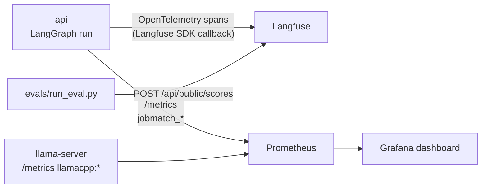
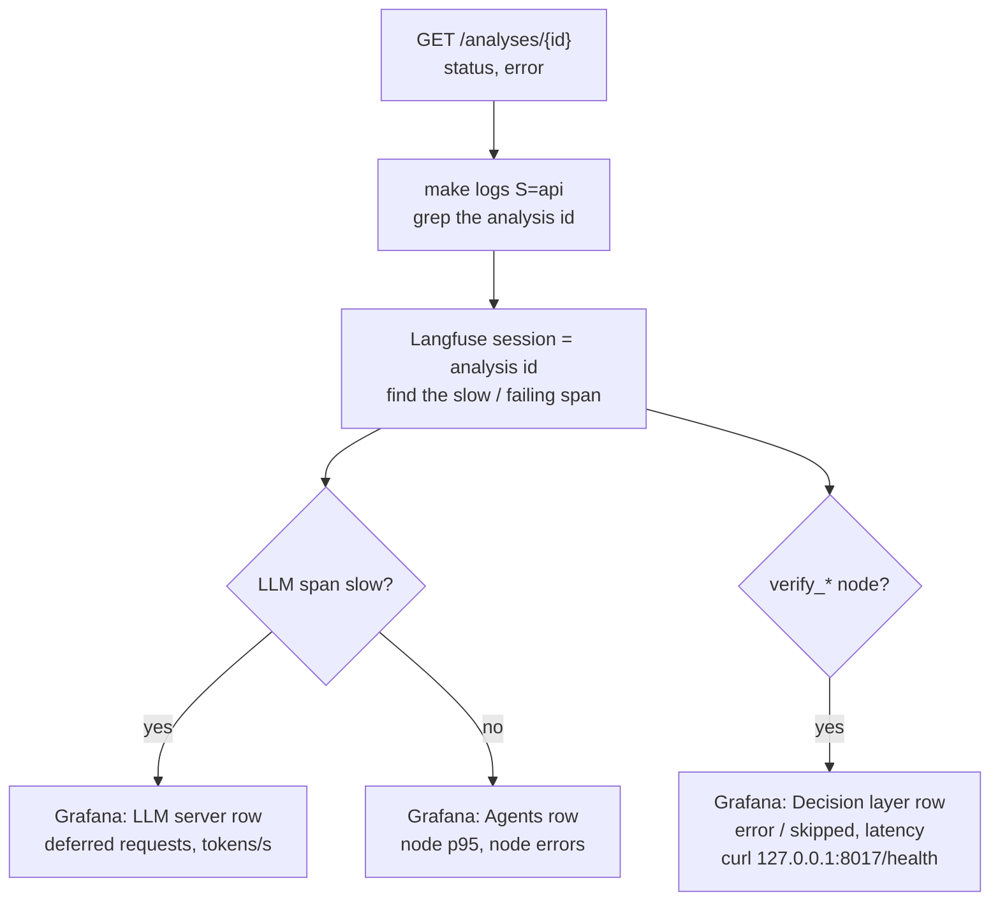

# Observability

Three complementary views of the same system:

| Tool | Question it answers | Granularity |
|---|---|---|
| **Langfuse** (self-hosted v4) | *What exactly happened in this analysis?* Prompts, outputs, tokens, timing of every node and LLM call. | One trace per analysis |
| **Prometheus** | *How is the system behaving over time?* Latency, errors, tokens, decisions, LLM server throughput. | Aggregated time series |
| **Grafana** | The Prometheus data as a provisioned dashboard. | Panels |

Plus structured logs (`key=value`) from the API.



## 1. Langfuse tracing

Source: `src/jobmatch/observability/tracing.py`, `src/jobmatch/api/service.py`.

### One trace per analysis

- The API creates a LangChain `CallbackHandler` for every run of the graph, with a
  **deterministic trace id**: `Langfuse.create_trace_id(seed=<analysis id>)`.
- An analysis runs in two phases: the first run stops at the `human_review` interrupt, and the
  resume runs after `POST /analyses/{id}/decision`. Both use the same seed, so **both land in
  the same trace**. A "request changes" round also lands there.
- Trace attributes come from the run config metadata (`langfuse_run_config`):

| Attribute | Value |
|---|---|
| Trace name | `jobmatch-analysis` |
| Session id | the analysis id |
| Tags | `jobmatch` (evals add `eval`) |
| Metadata | `analysis_id` |

### What a trace contains

Spans follow the graph. Node span names are the same as the Prometheus `node` label:

```
jobmatch-analysis
├── supervisor
├── analysis_team ── parse_offer, parse_cv           (LLM generations inside)
├── matching_team ── score_match, verify_skills, analyze_gaps
├── career_team   ── career_advisor ⇄ career_tools (tool calls), career_plan
├── writing_team  ── write_letter, review_letter, verify_claims (repeated per loop)
└── human_review                                      (interrupt, then resume)
```

Inside the nodes you find the `ChatOpenAI` generations (prompt, completion, token usage,
latency) and the LangChain runnables of structured output parsing. The decision-model calls
(jevos) are plain HTTP calls: they show up as the duration of `verify_skills` /
`verify_claims` (and of `career_tools` for `check_cv_evidence`), and their results are in the
node outputs (`match.skill_checks`, `review.claim_checks`). In `career_team`, each
`career_advisor` turn is a generation whose tool calls (names and arguments) are visible, and
each `career_tools` span shows the tool results fed back to the LLM.

### Opening a trace

- **By session:** Langfuse UI → *Sessions* → the analysis id, or
  `http://127.0.0.1:3000/project/jobmatch/sessions/<analysis-id>`.
- **By trace id:** compute it from the analysis id, then open
  `http://127.0.0.1:3000/project/jobmatch/traces/<trace-id>`:

  ```bash
  uv run python -c "from langfuse import Langfuse; print(Langfuse.create_trace_id(seed='<analysis-id>'))"
  ```
- **From the list:** *Tracing* → filter by name `jobmatch-analysis` or tag `jobmatch` / `eval`.

Login: `admin@jobmatch.local` / `jobmatch-admin` (local defaults, see `operations.md`).

The legacy `GET /api/public/traces` endpoint is disabled in Langfuse v4 `events_only` mode.
Read traces in the UI or in ClickHouse (`events_core` table); see
[operations.md, Troubleshooting](operations.md#langfuse-get-apipublictraces-returns-an-error).

### Tracing never breaks the app

`get_langfuse_handler` returns `None` when `LANGFUSE_ENABLED=false`, when Langfuse's health
endpoint does not answer (2 s timeout, result cached 30 s, logged as
`event=langfuse_unreachable`) or on any SDK error (`event=langfuse_handler_error`). The
analysis then runs untraced.

### Eval scores on traces

`evals/run_eval.py` traces every graph run with seed `eval-<case>[-r<i>]-<timestamp>` (stored
in the cached output), tag `eval`, and session id `eval-<case>[-r<i>]-<8 hex chars>`. After judging, every metric is posted as a Langfuse score
named `eval_<metric>` on that trace (`POST /api/public/scores`, score id `<trace>-<metric>` so
re-judging overwrites it):

`eval_score_in_range`, `eval_skills_recall`, `eval_gaps_recall`, `eval_letter_faithfulness`,
`eval_letter_relevance`, `eval_gap_usefulness`.

This lets you open the trace of a low-scoring case and read the exact letter and review that
the judge saw. See `evals/README.md`.

## 2. Prometheus metrics

Scrape config: `infra/prometheus/prometheus.yml` (every 15 s, retention 15 days).

| Job | Target | Metrics |
|---|---|---|
| `jobmatch-api` | `api:8000/metrics` | `jobmatch_*` |
| `llama-server` | `172.17.0.1:8080/metrics` (host) | `llamacpp:*` (needs `--metrics`) |
| `prometheus` | `localhost:9090` | self |

### Metrics catalog: `jobmatch_*`

Defined in `src/jobmatch/observability/metrics.py` (the names are a contract: the dashboard
depends on them).

| Metric | Type | Labels | Meaning | Recorded in |
|---|---|---|---|---|
| `jobmatch_http_requests_total` | counter | `method`, `route`, `status` | HTTP requests. `route` is the route **template** (low cardinality); `/metrics` itself is not counted. | `HttpMetricsMiddleware`, `api/main.py` |
| `jobmatch_http_request_duration_seconds` | histogram | `method`, `route` | HTTP latency. | `HttpMetricsMiddleware`, `api/main.py` |
| `jobmatch_agent_node_duration_seconds` | histogram (0.1 … 300 s) | `node` | Duration of one graph node execution. | `@instrument_node`, every node |
| `jobmatch_agent_node_errors_total` | counter | `node` | Exceptions raised inside a node (LangGraph interrupts excluded). | `@instrument_node` |
| `jobmatch_llm_tokens_total` | counter | `node`, `kind` (`prompt` / `completion`) | LLM tokens from the response usage metadata. | `record_llm_usage`, called by `graph/structured.py` |
| `jobmatch_analyses_total` | counter | `status` (`completed` / `rejected` / `failed`) | Finished analyses. | `AnalysisService._after_run` / `_mark_failed`, `api/service.py` |
| `jobmatch_analyses_in_progress` | gauge | – | Graph runs currently executing (an analysis waiting for approval is not running). | `AnalysisService._run` |
| `jobmatch_match_score` | histogram (10 … 100) | – | Final match score of finished analyses. | `AnalysisService._after_run` |
| `jobmatch_review_iterations` | histogram (0 … 5) | – | Writer/reviewer loops per finished analysis. | `AnalysisService._after_run` |
| `jobmatch_decision_duration_seconds` | histogram (0.01 … 10 s) | `task` (`skill_evidence` / `claim_supported`) | Duration of one decision-model call, as seen by the api. | `decisions/service.py` `_ask_yes` |
| `jobmatch_decisions_total` | counter | `task`, `outcome` (`yes` / `no` / `error` / `skipped`) | Decision answers (calibrated P(yes) ≥ 0.5 = `yes`). `error` = backend unreachable or failed, `skipped` = disabled, state too long, or HTTP 422. | `decisions/service.py` `_ask_yes` / `_degrade` |
| `jobmatch_decision_llm_agreement_total` | counter | `task`, `agree` (`true` / `false`) | Decision model vs LLM on the same question. | `check_skill_evidence`, `check_claims` |
| `jobmatch_skill_resolution_total` | counter | `resolution` (`llm` / `resolved_partial` / `conflict`) | Fusion v2 outcome per offer skill: `llm` = LLM rating kept, `resolved_partial` = LLM `partial` replaced by the calibrated P(evidence), `conflict` = strong disagreement, partial credit 0.5. | `check_skill_evidence`, `decisions/service.py` |
| `jobmatch_claims_dismissed_total` | counter | – | Reviewer "unsupported claim" issues dismissed by the decision model. | `verify_claims`, `graph/teams/writing.py` |
| `jobmatch_career_tool_calls_total` | counter | `tool`, `status` (`ok` / `empty` / `error`) | Tool calls chosen by the career advisor (autonomous agent). | `graph/teams/career.py` `_run_tool` |
| `jobmatch_career_rounds` | histogram (0 … 10) | – | Tool-calling LLM turns per career-advisor run (capped by `CAREER_MAX_TOOL_ROUNDS`). | `career_plan` |
| `jobmatch_career_resources_dropped_total` | counter | – | Resource URLs in the LLM plan that no tool returned (hallucinations removed). | `career_plan` |

Decision-metric label combinations are pre-created at import, so they export zeros before the
first decision. The Python client also exports `*_created` series for counters and histograms.

**Caveat: career evidence checks share the `skill_evidence` metrics.** `check_cv_evidence`
calls `check_skill_evidence` with an LLM rating of `partial`, so every career CV check is also
counted in `jobmatch_decisions_total{task="skill_evidence"}`,
`jobmatch_decision_duration_seconds`, `jobmatch_decision_llm_agreement_total` (where "agree"
then only means P ≥ 0.5) and `jobmatch_skill_resolution_total{resolution="resolved_partial"}`.
With the career advisor on, read those panels as "verify_skills + career checks".

How agreement is defined:

- `skill_evidence`: agree when (LLM credit ≥ 0.5) == (P(evidence) ≥ 0.5).
- `claim_supported`: the reviewer said "unsupported", so the model agrees when
  P(supported) < 0.5.

LangGraph control flow is not counted as an error: `@instrument_node` re-raises
`GraphBubbleUp` subclasses (`GraphInterrupt` raised by `interrupt()` in `human_review`,
`ParentCommand`, ...) without incrementing `jobmatch_agent_node_errors_total`. An approval
pause therefore does not show up in the error panel. The duration recorded for that pause is
the time until the interrupt.

### llama.cpp metrics used

Exposed by llama-server with `--metrics` (names as scraped from the running build):

| Metric | Meaning | Used in |
|---|---|---|
| `llamacpp:tokens_predicted_total` | Generated tokens (counter). | Generation tokens / s |
| `llamacpp:predicted_tokens_seconds` | Average generation speed of recent requests (gauge). | Generation tokens / s |
| `llamacpp:prompt_tokens_total` | Prompt tokens processed (prefill). | Prompt tokens / s, cache reuse |
| `llamacpp:prompt_tokens_cached_total` | Prompt tokens served from the prompt cache. | Prompt tokens / s, cache reuse |
| `llamacpp:prompt_tokens_seconds` | Average prefill speed (gauge). | Prompt tokens / s |
| `llamacpp:requests_processing` | Requests being processed by a slot. | Requests processing / deferred |
| `llamacpp:requests_deferred` | Requests queued, waiting for a free slot. | Requests processing / deferred |
| `llamacpp:n_busy_slots_per_decode` | Average busy slots per decode step (max 2 here). | Slot utilisation |

Also exported but not on the dashboard: `llamacpp:n_decode_total`, `llamacpp:n_tokens_max`,
`llamacpp:prompt_seconds_total`, `llamacpp:tokens_predicted_seconds_total`,
`llamacpp:spec_decode_*`. This build does **not** expose a KV-cache usage metric
(`llamacpp:kv_cache_usage_ratio` is absent).

## 3. Grafana dashboard

`JobMatch — Agents & LLM` (uid `jobmatch-overview`, folder `JobMatch`), provisioned from
`infra/grafana/dashboards/jobmatch.json`. URL: http://127.0.0.1:3001/d/jobmatch-overview.
Default range: last 6 h, refresh 30 s.

| Row | Panel | Question it answers |
|---|---|---|
| **Overview** | Analyses completed / rejected / failed | How many analyses finished, and how? |
| | Analyses in progress | Is something running right now? |
| | Median match score | Are scores drifting? (red < 50, orange < 70, green ≥ 70) |
| | API error rate (5xx) | Is the API healthy? (green < 1 %, red ≥ 5 %) |
| **Agents** | Node duration p50 / p95 | Which node is slow? |
| | Node errors by node | Which node fails? |
| | LLM tokens / min by node and kind | Which node consumes the LLM, prompt vs completion? |
| | Review iterations distribution | Does the writer/reviewer loop converge or hit its cap? |
| | Match score distribution | Spread of scores over the range. |
| **API** | Requests / s by route and status | Traffic and 4xx / 5xx per route. |
| | Latency p95 by route | Is an endpoint slow? |
| **LLM server (llama.cpp)** | jobmatch-api scrape, llama-server scrape | Can Prometheus reach both targets (`up`)? |
| | Generation tokens / s | Decode throughput (about 37 tok/s on the RX 7900 XTX according to the README). |
| | Prompt tokens / s | Prefill throughput, processed vs cached. |
| | Requests processing / deferred | Are both slots busy, are requests queuing? |
| | Slot utilisation & prompt cache reuse | Busy slots per decode, share of prompt tokens served from cache. |
| **Decision layer (jevos)** | Decision model vs LLM agreement | How often do System 1 and System 2 agree, per task? |
| | Reviewer claims dismissed | How many reviewer false positives the decision model caught. |
| | Decisions / min by task and outcome | yes / no volume, plus `error` (fallback to LLM-only) and `skipped` (state too long). |
| | Decision latency p50 / p95 by task | Is jevos still in the ~50 ms range? |
| | Skill resolution (fusion v2) | Per offer skill: LLM rating kept, `partial` resolved by jevos, or strong conflict (partial credit). Many `conflict` = System 1 and System 2 disagree often. |
| **Career advisor (agent)** | Career tool calls / min by tool and status | Which tools does the autonomous advisor choose, and do they return something (`ok` / `empty` / `error`)? |
| | Career advisor tool rounds per run | Does the ReAct loop stop on its own or hit `CAREER_MAX_TOOL_ROUNDS`? |
| | Hallucinated resource URLs dropped | How many URLs the LLM put in the plan that no tool returned (removed by post-validation). |

### Example PromQL

```promql
# p95 duration of each node over the last hour
histogram_quantile(0.95, sum by (le, node) (rate(jobmatch_agent_node_duration_seconds_bucket[1h])))

# average seconds per node execution (rough cost breakdown)
sum by (node) (rate(jobmatch_agent_node_duration_seconds_sum[1h]))
  / sum by (node) (rate(jobmatch_agent_node_duration_seconds_count[1h]))

# completion tokens per node over 24 h
sum by (node) (increase(jobmatch_llm_tokens_total{kind="completion"}[24h]))

# share of failed analyses over 24 h
sum(increase(jobmatch_analyses_total{status="failed"}[24h]))
  / clamp_min(sum(increase(jobmatch_analyses_total[24h])), 1)

# decision layer degraded? (errors or skips per minute)
sum by (task, outcome) (rate(jobmatch_decisions_total{outcome=~"error|skipped"}[5m])) * 60

# System 1 / System 2 agreement rate per task over 24 h
sum by (task) (increase(jobmatch_decision_llm_agreement_total{agree="true"}[24h]))
  / sum by (task) (increase(jobmatch_decision_llm_agreement_total[24h]))

# requests waiting for a llama-server slot
sum(llamacpp:requests_deferred)
```

Query them at http://127.0.0.1:9090/graph or via the API:
`curl -s '127.0.0.1:9090/api/v1/query' --data-urlencode 'query=up'`.

## 4. Logs

The API logs one line per event, `key=value` style (`api/main.py`, `api/service.py`):

| Event | When |
|---|---|
| `event=analysis_started` | `POST /analyses` accepted |
| `event=analysis_awaiting_approval` | first run reached `human_review` (with `duration_s`) |
| `event=analysis_resumed` | human decision received |
| `event=analysis_finished` | final status, score, `duration_s` |
| `event=analysis_failed` | exception in the graph (with `phase` and the error) |
| `event=langfuse_unreachable` / `event=langfuse_handler_error` | tracing disabled for this run |
| `decisions[<task>] unavailable, falling back to LLM-only results` | first decision-layer failure (later ones at DEBUG) |
| `verify_claims: dismissed (p_supported=…)` | a reviewer claim was dismissed |

`make logs S=api`; set `LOG_LEVEL=DEBUG` for more detail.

## 5. Debugging a slow or failed analysis



1. **Status.** `curl -s 127.0.0.1:8000/analyses/<id> | jq '{status, error}'`. A failed
   analysis keeps the exception text in `error`.
2. **Logs.** `make logs S=api | grep <id>`: `event=analysis_failed` gives the phase (`start` or
   `resume`) and the exception. `duration_s` on `analysis_awaiting_approval` /
   `analysis_finished` gives the total time.
3. **Trace.** Open the Langfuse session for the analysis id. The span tree shows which node
   failed or took the time, the exact prompt and output, and token counts. A long
   `writing_team` with several `write_letter` / `review_letter` pairs means the loop hit its cap
   (`MAX_REVIEW_ITERATIONS`).
4. **Node latency panel.** Compare the node's p95 with its usual value. If every LLM node is
   slow at once, the cause is the LLM server, not the node.
5. **LLM server row.** `requests_deferred` > 0 means both slots are busy (for example an eval
   running at the same time); low generation tokens / s means GPU contention. Check
   `/ready` and `curl -s http://172.17.0.1:8080/health`.
6. **Decision layer row.** `outcome="error"` means jevos was unreachable (the analysis
   continued LLM-only); `skipped` means the CV was too long for jevos' 8192-token context.
   Check `curl -s 127.0.0.1:8017/health` (`"status": "ready"`); `GET /ready` then shows
   `"degraded": true` with the `decisions` check failing. The "Skill resolution" panel shows
   how often fusion v2 actually changed a skill credit (`resolved_partial`, `conflict`).
